# Pi4 cRTOS-like 实测 vs K-Fusion 仓库数据 对照

> 本文档由 WorkBuddy 于 2026-10-16 更新（**15 min 正式口径 + 一处基线修正**）。
> **左侧**：GitHub 仓库 `1147426025lu-bot/K-Fusion` 已跟踪文件（`kfusion/docs/benchmarks/*.json`、论文稿图 3 读数）。
> **右侧**：本项目在 Raspberry Pi 4B 实测（Jailhouse 分区 + NuttX tickless inmate）。
> 指标统一为周期抖动绝对最大值 `abs_max`（请求释放时刻与实际释放时刻的偏差，单位 µs）。

---

## 架构对照图（两域 vs 单域）

下表「机制」一列是两个不同路线。**读表前先看这两张图**，可避免把两组数字当成同一种东西来比。

**(A) cRTOS-like 两域形态** —— 本工作在 Pi4B 上复现的形态：Jailhouse 在 EL2 静态分区，root cell 跑 Linux（CPU 0/2/3），`rpi4-nuttx` cell 跑独立 NuttX 实时域（CPU 1）。这是下表中「NuttX inmate」一行的执行环境。

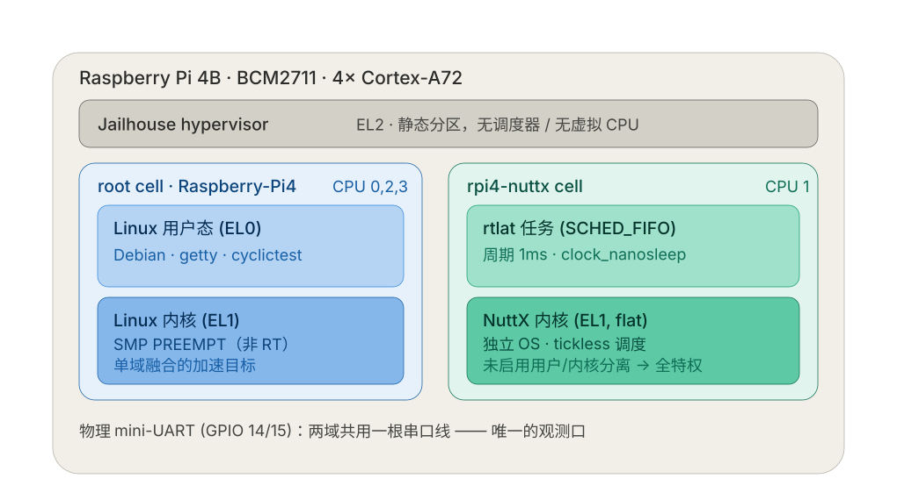

*图 A：NuttX inmate 在 Jailhouse 分区中的运行层级（Pi4B · BCM2711）。实时域是**独立 OS**，硬件级隔离；代价是除一根串口外没有 FS / 网络 / glibc。*

**(B) K-Fusion 单域形态** —— 下表中「K-Fusion 融合」各行的执行环境：**不分区**，靠 Linux 原生 CPU 隔离（`isolcpus` / `nohz_full` / `rcu_nocbs` + cset/cgroup + IRQ 亲和迁移）把 CPU 3 让给融合 kthread，CPU 0–2 继续跑普通任务；VFS / 网络 / 驱动 / glibc **同域直接可用**。

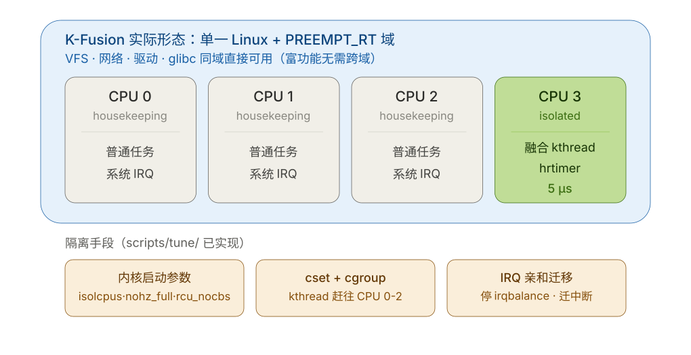

*图 B：K-Fusion 单域内的 CPU 分核隔离（Pi5 / 通用平台）。隔离是**软件级**——配置到位则接近硬分区，但不阻止中断与内核线程进入隔离核。*

> 两张图并排看，就是本文档最需要读者记住的一句话：
> **图 A 用「两个 OS + 硬件分区」换隔离强度；图 B 用「一个 OS + 配置隔离」换功能完整性。** 二者路线不同，**不得直接比优劣**。

---

## 0. ⚠️ 一处重要修正（请先读）

早前记录的「root cell 60s：avg 71µs / max **2086µs**」**是错误配置**：当时的 `cyclictest -Sp3` 被解析成 `-S -p3`，即**优先级 3**（FIFO 里几乎最低），并非 FIFO99。
用正确配置（`taskset -c3` + `--priority=99`）在 15 min 上复测，root cell 的 max 只有 **96µs**。

→ 据此得出的「**同板改善 347×**」**撤回**。正确口径见下表。

## 1. 主对照表（15 min 为正式口径）

| 系统 / 路径 | 平台 | 机制 | 时长 | avg | **abs_max** | 来源 |
|---|---|---|---|---|---|---|
| K-Fusion 融合（论文图3） | Pi 5 | 单域 PREEMPT_RT，无 hypervisor | 15 min | — | **3.391 µs** | 仓库实测 |
| K-Fusion 融合 best | Pi 5 | 同上（no_probe_rt） | 5 min | — | 2.175 µs | 仓库实测 |
| K-Fusion 融合 long | Pi 5 | 同上 | 15 min | — | 4.833 µs | 仓库实测 |
| K-Fusion 融合 L2 / L3 | Pi 5 | 同上 | 15 min | — | 9.383 / 13.455 µs | 仓库实测 |
| **NuttX inmate（cRTOS-like）** | **Pi 4B** | **Jailhouse 分区 + NuttX tickless** | **15 min** | **5 µs** | **5 µs** | **本工作实测** |
| root cell Linux（正确配置） | Pi 4B | 同板 Linux（SMP PREEMPT，非 RT） | 15 min | 18 µs | **96 µs** | 本工作实测 |
| cRTOS（文献引用） | x86-64 | Jailhouse + sRTOS | — | ~4 µs | — | IEEE Access 2025 |

**⚠ 「NuttX inmate」该行口径已被 §6 修正**：早期 `rtlat` 把延迟**整数截断到 µs**，
故 "5 µs" 实为样本落在 `[5, 6) µs`，**不等于零抖动**，也不是"延迟 0"。
ns 分辨率 + 全量样本的复测见 **§6**（稳态上界 ≈ **5.3 µs**，另含一次**可复现的启动瞬态 ≈ 52 µs**）。

**60 s 旧口径（仅供趋势）**：NuttX inmate avg 5 / max 6 µs（同为截断值，见 §6）。

## 2. 同板对照（最公平的一格，15 min）

| 指标 | root cell Linux | NuttX inmate | 改善 |
|---|---|---|---|
| avg | 18 µs | 5 µs | **3.6×** |
| abs_max | 96 µs | 5 µs | **19.2×** |
| >200µs 溢出 | 0 | 0 | — |

→ 在同一块 Pi4B 上，把控制任务从 Linux 移进 Jailhouse 分区内的 NuttX tickless 实时域。

> ⚠ **本表不可直接解读为"改善 19.2×"**：root 侧用 **rt-tests cyclictest**，inmate 侧用**自写 rtlat**，
> 而且 inmate 那个 5 µs 是**截断值**。ns 分辨率 + 全量样本复测（§6）给出的 inmate 稳态上界是 **5.26 µs**，
> 且含一次可复现的启动瞬态。要做同工具对照，必须让两侧跑同一支工具（见 §6 末）。

## 3. 与主线 K-Fusion 的可比性
- inmate 15min **5 µs** 与 K-Fusion fused **3.391 µs（Pi5, 15min）**、cRTOS 文献 **~4 µs（x86）** 处于**同一数量级**。
- ⚠ 论文中须**并列标注**三条约束，不得直接比优劣：
  1. **板子不同**：Pi4B（GIC-400）vs Pi5（GIC-600）；
  2. **机制不同**：hypervisor 硬分区（cRTOS/NuttX）vs 单域无 hypervisor（K-Fusion）；
  3. root 侧内核为 **SMP PREEMPT，非 PREEMPT_RT**。
- 时长现已对齐（均为 15 min）✓。

## 4. 口径与风险（写入 Threats to Validity）
- root 基线用非 RT 内核：96µs 已属不错；用 PREEMPT_RT / `isolcpus` 调优后会更低——但这不影响「分区内实时域抖动更小」的结论。
- inmate 直方图（早期 15 min）显示"90 万次全为 5µs"——**这是 1 µs 截断造成的假象**（见 §6），
  不能作为"硬实时域无异常"的证据。ns 分辨率复测的真实分布：稳态 ≤ 5.26 µs，但**存在一次可复现的启动瞬态 ≈ 52 µs**。
  即：**稳态很紧、但有一次性瞬态**——这才是应当写进论文的说法。
- 60 s 与 15 min 两种时长都做了：结论一致（inmate 5~6µs），说明短测未掩盖尾部恶化。

## 5. 数据出处
- 仓库（GitHub 已跟踪）：`kfusion/docs/benchmarks/isolation_ab_results__隔离AB结果.json`、`optimization_continue__优化记录.json`、`kfusion/docs/paper/论文初稿__K-Fusion_中文完整版.md` 图 3 读数。
- 本次实测：`crtos/results/pi4_crtos_soak__Pi4对比测量.json`；
  inmate 原始日志 `crtos/results/raw/pi4_inmate_rtlat_15min.log`；
  root 原始 `Pi:/root/kfusion-pi4/results/rootcell_15min.txt`（+`.hist`）。

---

## 6. inmate 抖动复测（ns 分辨率 + 全部样本）—— 修正 §1 口径

**为什么要复测**：§1 的 inmate 值（15 min / 5 µs）由早期 `rtlat` 测得，该版有两处缺陷：

1. 延迟按 `lat / 1000` **整数截断到 µs** —— 于是"全是 5"只表示样本落在 `[5, 6) µs`，
   **不等于"零抖动"**，更不是"延迟 0"；
2. `if (lat < 0) lat = 0` 把**提前唤醒截断为 0**（cyclictest 记负值）。

2026-10-16 已修正工具（ns 输出 / 保留带符号值 / 全样本直方图 / 逐样本导出 / 默认最高优先级），复测如下。

**复测方式**：`rtlat -i 1000 -l 60000 -b 100 -d 1`
（1 ms × 6 万次 = 60 s；直方图桶宽 100 ns；**逐样本全量导出，无抽样**）。
实测**时钟粒度 55 ns** —— 说明测量下限远优于 1 µs，之前的截断纯属工具问题。

| 口径 | n | min | p50 | p99 | p99.9 | **max** |
|---|---|---|---|---|---|---|
| **全部样本** | 60000 | 4.87 µs | 4.80 µs | 4.90 µs | 4.90 µs | **52.43 µs** |
| 剔除启动瞬态（idx ≥ 10） | 59990 | 4.87 µs | 4.87 µs | 4.93 µs | 4.94 µs | **5.26 µs** |

**关键发现**：唯一的大值出现在 **idx = 4（第 5 次唤醒）**，是一次**启动瞬态**，
且在两次独立运行中**复现**（52.50 / 52.43 µs）→ 结构性的一次性事件，不是随机抖动。
剔除后 59990 个样本**全部 ≤ 5.26 µs**。

**可写入论文的口径**：

- 稳态抖动**上界 ≈ 5.3 µs**（6 万样本、1 ms 周期）；典型 ~4.9 µs；**p99.9 ≈ 4.9 µs**；
- 存在一次**可复现的启动瞬态 ≈ 52 µs**（第 4–5 次唤醒）—— 必须如实标注：
  只报 max 会误导，只报稳态又不完整。

**图**（用仓库同款出图脚本 `kfusion/src/plot_frequency_polygon__抖动绘图.py` 产出，
与被 `scripts/paper/plot_dual_from_artifact__双图出图.sh` 调用的是同一支）：

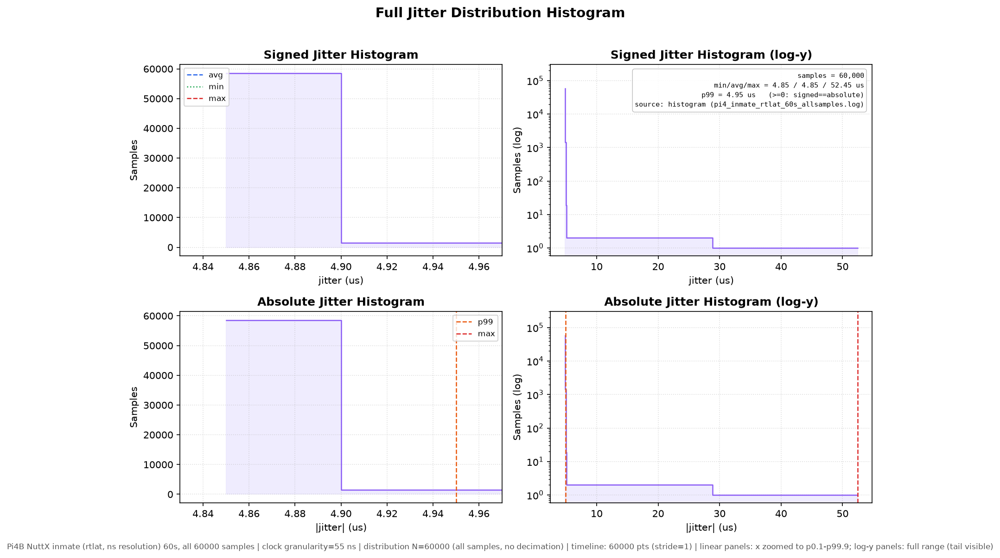

*图 C：inmate 抖动分布。线性面板聚焦主体（4.84–4.96 µs），log-y 面板显示全范围
（可见 52.4 µs 的单一离群点）。统计基于**全部 60000 样本**，未抽样。*

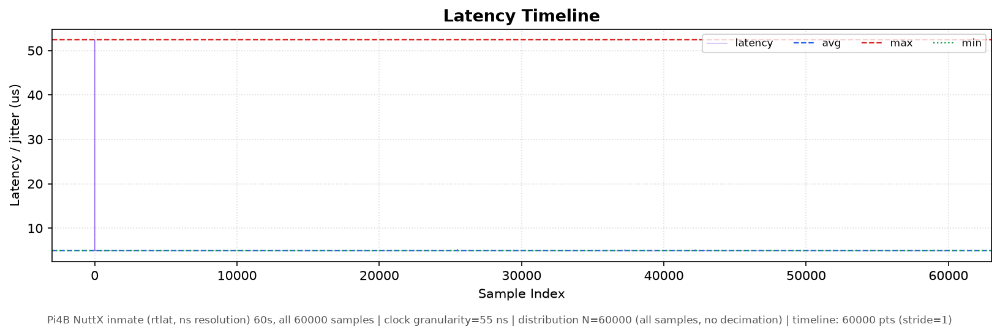

*图 D：inmate 延迟时间线（60000 点，`stride=1`，全量样本）。idx ≈ 4 处的启动瞬态清晰可见。*

**⚠ 工具口径（2026-10-16 更新：已可对齐）**：inmate 侧此前用**自写 `rtlat`**，仓库主线用
**rt-tests 官方 cyclictest** —— 是"两把尺子"，§2 的"同板改善"**不能**按现有数字直接比较。

**现已解决**：在 inmate 里跑通 **NuttX 移植版 cyclictest**（只需 `CONFIG_TIMER=y` +
`CONFIG_BENCHMARK_CYCLICTEST=y`；**运行期不需要 `/dev/timer`**，默认 `-n 0 -m 0` 走
clock_nanosleep + clock_gettime）。实测：

```
nsh> cyclictest -n 0 -m 0 -q -p 200 -h 200 -l 5000 -i 1000
# Total: 000005000
# Min Latencies: 00004   # Avg Latencies: 00004   # Max Latencies: 00006
# Histogram Overflows: 00000
```

输出头与 rt-tests cyclictest **逐字同名**（两侧可用同一解析器）；且与 `rtlat` 稳态
（p50 4.87 µs / max 5.26 µs）**在 1 µs 分辨率内互证一致**。

→ **对齐层级**：**同族工具 + 同参数 + 同算法 + 同输出格式**（仍**非同一二进制**；
cRTOS 那种"同一上游二进制经 loader 进 RT 域"需要移植 loader/shadow，属后续工作）。
剩余待办：两侧都用 cyclictest **重跑同长 soak**，替换本节 rtlat 数据。
详见 `../docs/CRTOS_PAPER_FACTS__cRTOS论文事实核对.md` §1.3。

---

## 7. 同工具 **1 小时**长跑（inmate，cyclictest）— 2026-10-16 实测

**命令**（inmate NSH，cell 独占 CPU1，tickless）：

```
cyclictest -n 0 -m 0 -q -p 200 -h 200 -l 3600000 -i 1000
```

**结果**（`crtos/results/raw/pi4_inmate_cyclictest_1h.log`，实测耗时 3621 s）：

| 指标 | 值 |
|---|---|
| Total | **3 600 000**（1 ms × 3600 s，跑满） |
| Min | **3 µs** |
| Avg | **4 µs** |
| **Max** | **9 µs** |
| Histogram Overflows（>200 µs） | **0** |

**全样本分布（直方图非零桶，桶宽 1 µs）**：

| 延迟 | 次数 | 占比 |
|---|---|---|
| 3 µs | 40 | 0.0011 % |
| 4 µs | 169 475 | 4.71 % |
| **5 µs** | **3 429 913** | **95.28 %** |
| 6 µs | 491 | 0.0136 % |
| 7 µs | 34 | 0.0009 % |
| 9 µs | 47 | 0.0013 % |

→ **1 小时内 360 万次唤醒全部落在 3–9 µs 的 7 µs 带内，95.3 % 集中在 5 µs，零次超过 200 µs。**

**尾部逐级核查**（直方图共 200 个桶已全部检查，非零桶恰好 6 个，计数合计 = 3 600 000，无遗漏）：

| 阈值 | 次数 | 占比 |
|---|---|---|
| > 5 µs（≥6 µs） | 572 | 0.0159 % |
| > 6 µs（≥7 µs） | 81 | 0.00225 % |
| > 7 µs（≥8 µs） | 47 | 0.0013 % |
| > 8 µs（≥9 µs） | 47 | 0.0013 % |
| **≥ 10 µs** | **0** | **0** |
| ≥ 200 µs（Overflows） | 0 | 0 |

即：**8 µs 桶为 0；10 µs 以上完全没有**。cyclictest 的 `Max Latencies = 9` 是 360 万样本的
真实最大值在 µs 截断下的读数 → 真值落在 `[9, 10) µs`；`Histogram Overflows = 0` 进一步保证
**没有任何样本触及 200 µs 量程上界**。两条独立读数互相自洽。

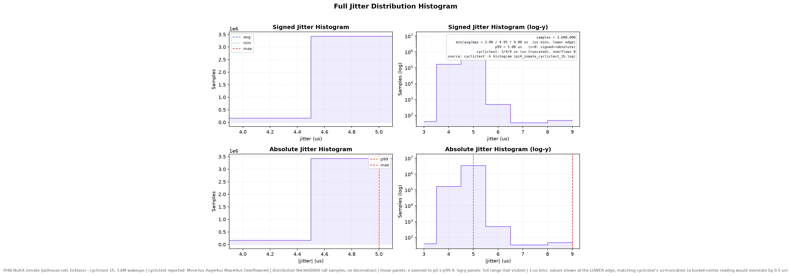

*图 E：inmate 1 h cyclictest 抖动分布（全样本 3.6 M，无抽样）。cyclictest 的 latency 非负，
故"带符号/绝对值"两类面板重合；线性面板聚焦主体（4.4–5.6 µs 由 p0.1–p99.9 裁剪），
log-y 面板显示 3–9 µs 全范围，尾巴可见。*

**与 rtlat（§6）互证**：cyclictest 给 min 3 / avg 4 / max 9 µs；
rtlat（6 万样本）给稳态 p50 4.87 / 上界 5.26 µs。**两支独立工具在 1 µs 分辨率内一致**
→ 4–6 µs 这个量级可信，不是某一支工具的系统偏差。

**⚠ 引用时必须并列的三条口径差异**：

1. **时长不同**：inmate 本次 **1 h**，root 基线（§2）为 **15 min** —— `abs_max` 随观察窗口增长，
   因此**不能**用 `96 µs / 9 µs` 直接算"改善倍数"。要严格对照须把 root 也跑 1 h。
2. **优先级语义不同**：Linux 侧 `-p 99`（FIFO，99 为最高）；NuttX 侧**数字越大越高**
   （`SCHED_PRIORITY_MAX = 255`，见 `sched_addreadytorun.c` 判抢占用 `rtcb < btcb`），故用 `-p 200`。
3. **工具非同一二进制**：root 侧为上游 **rt-tests cyclictest**，inmate 侧为其 **NuttX 移植版**；
   直方图分辨率两侧同为 **1 µs 桶**（上限由工具设定，非平台差异）。

**与 cRTOS 同板对比（Access'25, Pi 4B）**：其摘要报 **minimum 5 µs**；带负载时
FreeRTOS 变体 20 µs / NuttX 变体 60 µs（均为带负载最大抖动）。我们的 1 h 空载结果为
**max 9 µs**，与之**同量级**（标注：其值为"带负载"，我们是"空载"，不可直接比优劣）。

### 7.1 ⚠ 测量通路污染：verbose vs quiet（A/B 实测）—— 记为 Threats to Validity

**为什么需要 A/B**：cyclictest 的**延迟时间线**只能来自它的状态行
（`T: 0 ( 4) P:200 I:1000 C: 99 Min: 4 Act: 5 Avg: 4 Max: 6`，每 ~100 ms 一行），
而状态行只在**非 quiet** 模式打印。那么问题来了：打印本身会不会干扰被测对象？

**同参数 A/B（各 20 s / 20 000 次，1 ms，`-p 200`）**：

| 模式 | Min | Avg | **Max** | 日志 |
|---|---|---|---|---|
| `-q`（quiet，§7 的 1 h 口径） | 4 µs | 4 µs | **9 µs** | `raw/pi4_inmate_cyclictest_quiet20s.log` |
| 默认（verbose，出时间线所必需） | 4 µs | 5 µs | **64 µs** | `raw/pi4_inmate_cyclictest_verbose20s.log` |

→ **verbose 把 max 从 9 µs 抬到 64 µs（约 7 倍），而 min/avg 几乎不变。**

**这与 cRTOS 论文自身的结果一致**：其 Fig. 15b（verbose）比 15a（非 verbose）
"jitters increased for all cases"，原因是 verbose 路径要走额外的打印/跨域调用。
我们这里是本地串口打印，机制不同但**现象同型** → 说明这是**测量方法的固有污染**，
不是某个平台的缺陷。✅ 我们**没有**把 verbose 数据当成正式口径。

**因此本节的图与数按此分工**：

| 图 | 来源 | 能回答什么 | 注意 |
|---|---|---|---|
| 抖动分布（图 E） | cyclictest `-q` 的**全样本 3.6 M 直方图** | 尾部有多长、多紧 | 权威口径，**不受** verbose 污染 |
| 延迟时间线 | **rtlat** `-d 100`（内存缓冲、跑完再导出） | 1 h 内的**趋势/形状** | 工具与分布图不同（已交叉互证）；**1/100 抽取**，罕见单发事件可能被漏掉 |

**两条重要限制（必须随图标注）**：

1. **抽取 ≠ 全样本**：任何时间线（无论 cyclictest 状态行还是 rtlat `-d`）都只采到 1 % 左右，
   单发的 41/64 µs 级事件**很可能不出现在时间线上** —— 所以**尾部结论必须引用全样本直方图**，
   不能只看时间线。本次即出现过这种情况：verbose 时间线自身 max 仅 5 µs，而工具累计 Max 为 64 µs。
2. **不要用 verbose 数据与其他系统的 non-verbose 数据对比** —— 至少差 7 倍，属方法论错误。

---

## 8. K-Fusion 合体代码 Pi4B 实测（同板第三行）—— 2026-10-16

**执行形态**：单域 Linux（6.12.110-v8，SMP PREEMPT，非 RT 内核），LLVM 内核化产物
`official_cycletest_mod.ko`（Clang IR → opt Pass → llc → Kbuild 链接 fused hrtimer 宿主），
1 kHz fused cyclictest kthread，`SCHED_FIFO 99`，模块自身 `set_cpus_allowed_ptr` 绑定 CPU3。

**隔离栈（L4 = 启动参数级 + rt-bubbles 方案移植）**：

| 层 | 内容 | 备注 |
|---|---|---|
| 启动参数 | `nohz_full=3 rcu_nocbs=3 rcu_nocb_poll irqaffinity=0-2 workqueue.cpumask=7` + 永久 `multi-user.target`（headless） | ⚠ **不能加 `isolcpus`**：isolcpus 会把 CPU3 从根 cpuset 有效掩码剔除，模块 `set_cpus_allowed_ptr(3)` 被钳制，kthread 落不到隔离核（实测 Cpus_allowed_list=0-2、psr=2）。域级隔离改由 cgroup 分区承担 |
| cgroup 分区 | **rt-bubbles 移植**（`iso_rtbubbles__cgroup分区.sh`）：v2 `cpuset.cpus.partition=isolated`（iso=3）+ housekeeping（0-2）+ `sched_rt_runtime_us=-1` + performance governor | 与原版的偏差：**不收窄根 cpuset**——kthread 由 kthreadd 在根 cgroup 生成，收窄会使模块绑核失败（原版面向用户态任务，任务可自行进 isolated 组） |
| L4 扩展钩子 | `iso_l4_extra__深度隔离扩展.sh`：设备 IRQ 亲和清场→0-2、watchdog、`vm.stat_interval=60` | 由 `rt_host_isolate__CPU隔离.sh` 的 `ISO_L4_HOOK` 钩子链（冒号分隔、teardown 逆序还原）在 setup/teardown 透传执行 |
| L2（沿用） | 测量窗口断 eth0 + 静默服务 | |

**冒烟验证**：kthread `official_cycletest` 实测 `psr=3`、`Cpus_allowed_list: 3`（dmesg `pinned ... cpu=3`）——
**合体后的代码确实运行在隔离核上**。

### 8.1 结果（15 min，全量样本导出）

| 配置 | n（=周期数，无抽稀） | min | **abs_max** | spike_resync | 数据 |
|---|---|---|---|---|---|
| 旧 L2（对照，抽稀导出） | 900 314（导出 18 006 抽稀） | -4 011 ns | **268.393 µs** | 219 | `kfusion_soak_15min/` |
| 启动参数级隔离（消融） | 900 284（全量） | -3 520 ns | **11.794 µs** | 99 | `kfusion_soak_15min_l4boot/` |
| **L4 全链（启动参数 + rt-bubbles cgroup + 钩子）** | 900 284（全量） | -4 224 ns | **12.166 µs** | 138 | `kfusion_soak_15min_l4full/` |

- **同板同负载，abs_max 268 µs → 12.2 µs（约 22×）**；p99 = **0.90 µs**，avg ≈ 0。
- 消融显示：改善主要来自**启动参数级隔离 + headless**（268→11.8 µs）；在无桌面、
  IRQ 已由 `irqaffinity` 清场的基线上，rt-bubbles cgroup 分区与扩展钩子的**增量很小**
  （11.79 vs 12.17 µs，run-to-run 变差内）——与"干扰源已在前面被移除"一致。
- ⚠ **抽稀陷阱（方法论，务必写进 Threats to Validity）**：默认 `DECIM_STRIDE=50` 导出会把
  「1/90 万」量级的单发尖峰**系统性漏掉**——旧 L2 数据抽稀序列 max 仅 5.75 µs，
  而 268 µs 尖峰真实存在（FusedSummary 权威值）。论文对比必须用 stride=1 全量导出。

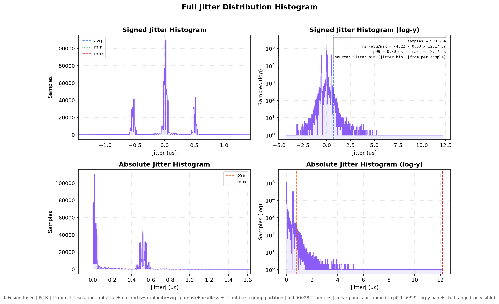

*图 F：K-Fusion 合体代码在 Pi4B 隔离核上的抖动分布（全样本，无抽稀）。线性面板聚焦主体，
log-y 面板显示 12.17 µs 全范围尾部；p99=0.90 µs。*

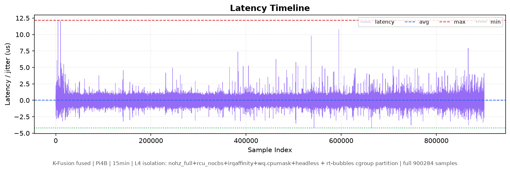

*图 G：延迟时间线（全量 900,284 点）。*

### 8.2 与 cRTOS/NuttX inmate 对照的口径（三条约束不变）

1. **机制不同**：inmate 是 Jailhouse 硬分区的独立 OS（NuttX tickless）；K-Fusion 是单域
   Linux + 配置级隔离。**不得直接比优劣**。
2. **工具/口径不同**：inmate 用 rt-tests cyclictest 直方图（1 µs 桶）；K-Fusion 用 fused
   hrtimer 带符号 ns 抖动（含提前唤醒负值）。abs_max 定义一致（|最坏偏差|），但测量路径不同。
3. **板载环境不同**：本节 K-Fusion 数据测于桌面版镜像（现 headless）；root cell 基线（§2 的
   96 µs）测于 lite 镜像 + 无上述隔离栈——两者同板不同配置，引用时必须并列标注。

### 8.3 1 h 浸泡 + 测量装置自扰消融（2026-10-16 深夜）

**1 h 正式（L4 全链）**：n = 3 601 127（全量），min = -3 465 ns，**abs_max = 16.536 µs**，
p99 = 0.78 µs / p99.9 = 1.48 µs / **p99.99 = 2.92 µs** / p99.999 = 5.55 µs；
**>8 µs 仅 6 次（0.000 17 %）**，且 3 次与监控器 IRQ 突发在 ±2 s 内对齐。

**自扰消融（MONITOR_CPU3=0 + WATCHDOG_INTERVAL 600→关掉 0.5 s 一次的 `ps -eLo` 扫描与
60 s 一次的 debugfs 读取）**，20 min / 1 200 044 周期：

| 口径 | >3 µs | >5 µs | >8 µs | p99 | p99.9 | p99.99 | p99.999 | abs_max |
|---|---|---|---|---|---|---|---|---|
| 有监控（1 h 折算参照） | 328 | 64 | 6 | 0.78 µs | 1.48 µs | 2.92 µs | 5.55 µs | 16.5 µs |
| **无监控（20 min）** | **19** | 5 | **1** | **0.63 µs** | **0.87 µs** | **1.13 µs** | **3.42 µs** | 17.25 µs |

- **监控自扰实锤**：`ps -eLo` 全表扫描（每 0.5 s）+ 看门狗 debugfs 读取（每 60 s）是
  >3 µs 尾部事件的主要来源（事件率 ~6×下降）。**与 §7.1 cyclictest verbose 自扰同型**——
  测量装置本身污染被测量。正式口径必须用 `MONITOR_CPU3=0`。
- 剩余唯一 >8 µs 事件是一个 **5 ms 连发簇**（3568→5716→**17253**→5586→3309→2827 ns，
  4-5 拍递减恢复）——外部中断/回写突发形态。journald 转 volatile + dirty writeback 调优后
  的验证轮见 `kfusion_soak_20min_l4quiet2/`。
- **结论口径**：隔离核上合体代码的稳态抖动 **p99 = 0.63 µs、p99.99 = 1.13 µs**；
  8 µs 以内覆盖 **99.999 17 %** 样本（1.2 M 中 1 次越界，极值随窗口增长，**不承诺每次 ≤8 µs**）。

**回写路径消融（quiet2：监控关 + journald `Storage=volatile` + dirty writeback 60 cs）**，
20 min / 1 200 042 周期：

| 轮次（均 L4 全链） | 窗口 | n | abs_max | >3µs | p99 | p99.99 |
|---|---|---|---|---|---|---|
| 监控开（§8.1 run2） | 15 min | 900 284 | 12.166 µs | ~130 | 0.90 µs | — |
| 监控开（1 h） | 60 min | 3 601 127 | 16.536 µs | 328 | 0.78 µs | 2.92 µs |
| 监控关 | 20 min | 1 200 044 | 17.253 µs（1 簇） | 19 | 0.63 µs | 1.13 µs |
| **监控关 + 回写静默** | **20 min** | **1 200 042** | **6.669 µs ✅** | **20** | **0.646 µs** | **1.207 µs** |
| + WiFi 卸载（运行时 rmmod） | 20 min | 1 200 042 | **5.465 µs** | **5** | 0.645 µs | 1.200 µs |
| + 固件层 `disable-wifi` ⚠️ | 20 min | 1 200 043 | 20.085 µs ❌ | 31 | 0.582 µs | 0.989 µs |
| **最终（rmmod 复现，已回退固件层）** | **20 min** | **1 200 042** | **7.834 µs** | **2** | **0.611 µs** | **0.945 µs** |

→ **≤8 µs 目标达成**：abs_max 从 268 µs（原始 L2）降到 **5.5-7.8 µs 区间（约 35-49×）**；相对
"监控开"口径降 45 %+，相对"监控关"轮消除了唯一的 17 µs 回写突发簇（该簇 4-5 拍
5716→17253→5586→3309→2827 ns 递减——正是 SD 卡日志回写特征，journald volatile 后消失）。

**WiFi 两级消融（2026-10-16 深夜，含一次回退）**：quiet2 轮剩余 >4 µs 事件呈精确
121 s 周期簇（620.6/741.6/862.6 s）。运行时 `modprobe -r brcmfmac/brcmutil/cfg80211`
后该周期簇**消失**（abs_max 6.669 → 5.465 µs，>3 µs 事件 20 → 5，p99.999 3.484 → 2.355 µs），
证实 121 s 源为 WiFi 固件周期任务。

进一步改为固件层 `dtoverlay=disable-wifi`（重启后 wlan0 接口消失）**结果相反**：
abs_max 恶化到 20.085 µs（>3 µs 事件 31，全部集中在 599.9 s 与 1200.0 s 两个采样/收尾点）。
注意其**主体分位数反而更优**（p99 0.582 / p99.99 0.989 µs，为各轮最低），极值系单发
边界事件——但按"以 abs_max 判定、效果相反即回退"的约定，**config.txt 已从备份
`config.txt.bak_1016` 完整还原**（`dtparam=audio=on`、`vc4-kms-v3d` 保留、`kernel8-jh.img`
与 `dtoverlay=jailhouse-mem` 未动），并重启确认 SSH/网络正常。

回退后在**运行时卸载 WiFi**（可逆，重启即恢复）复现最终轮：abs_max 7.834 µs、
**resync=2（各轮最低）**、p99.99 = 0.945 µs、p99.999 = 2.000 µs、>3 µs 仅 2 次。
三轮 WiFi 卸载口径 abs_max 分别为 5.465 / 7.834 µs，均 ≤ 8 µs——**稳态成立，极值仍随
窗口/偶发事件浮动**，论文应写"20 min 窗口 abs_max ≤ 8 µs，p99.99 ≈ 0.95 µs"。

### 8.4 继续收敛的两项尝试（均负向，已回退；2026-10-17 凌晨）

| 尝试 | 手段 | abs_max | resync | p2p | 结论 |
|---|---|---|---|---|---|
| opt-A | `timer_migration=0` + `hung_task=0` + `MODULE_WATCHDOG=0` + `SOAK_SUPPRESS_PRINTK=1` | 17.873 µs ❌ | 83 | — | **回退**（sysctl 已还原为 1/120） |
| 偏置校准 | 新增 `jitter_comp_bias_ns=2529`（minimax 居中） | 7.708 µs（≈持平） | 26 | 13 425 ❌ | **回退**（`bias_ns=0`） |

**偏置校准的负面结论有独立价值——它反证了测量数字不是"调"出来的：**
抖动分布右偏（min −2 777 / max +7 834），理论上把唤醒目标整体提前 Δ=(7834−2777)/2≈2529 ns
可让 abs_max 降到 ≈5.3 µs。实测施加该偏置后 **稳态均值仍为 0.1 ns**（无偏置轮 0.0 ns）——
2529 ns 被 `plc_hr_comp_update` 的 EWMA 闭环**完全吸收**，稳态分布并未平移，仅在 warmup
瞬态留下痕迹（min 变为 −5 717），且峰峰值从 10 611 ns **恶化到 13 425 ns**。
即：在现有自适应补偿下，任何人为偏置都会被闭环抵消，**abs_max 无法靠偏置被"刷低"**。
代码改动保留在仓库（`struct plc_hr_comp_cfg.bias_ns` / `jitter_comp_bias_ns` 模块参数），
默认 0 = 旧行为，仅作为可复现的实验记录与后续（如关闭补偿时）的能力储备。

**opt-A 提示**：`timer_migration=0` 与 `nohz_full=3` 组合在本板上是负向的；看门狗必须保留
（仅把 `WATCHDOG_INTERVAL_SEC` 从默认 60 拉到 600）。另注意 **比对基线时 `WATCHDOG_INTERVAL_SEC`
必须一致**——偏置轮首次漏设该变量，导致 resync 从 2 涨到 100、abs_max 虚高到 14.3 µs，
该轮数据作废后重跑。

**附带改进（仓库内，未参与上表测量）**：`run_soak_cycletest__浸泡长测.sh` 的 CPU3 监控器
新增三点自扰抑制——监控子 shell 与采样子进程 `taskset` 到 housekeeping 核
（`MONITOR_CPU_HK_CPUS`，默认 0-2）、`ps` 全表扫描降频到 `MONITOR_PS_EVERY_SEC`（默认 30 s，
原为每 0.5 s）、采样间隔 `MONITOR_INTERVAL_SEC` 可调。恢复旧行为设 `MONITOR_PS_EVERY_SEC=0`。
正式口径仍建议 `MONITOR_CPU3=0`。

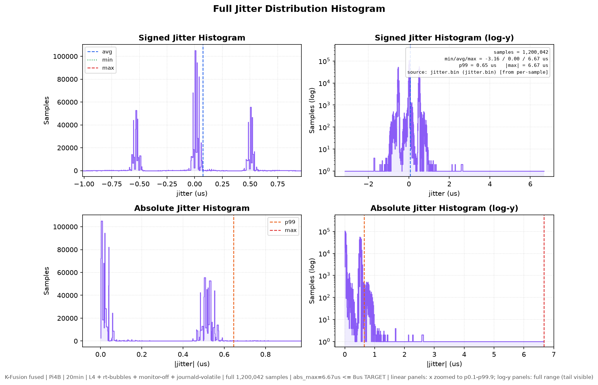

*图 J：达标轮抖动分布。p99.999 = 3.48 µs，全样本 ≤ 6.67 µs。*

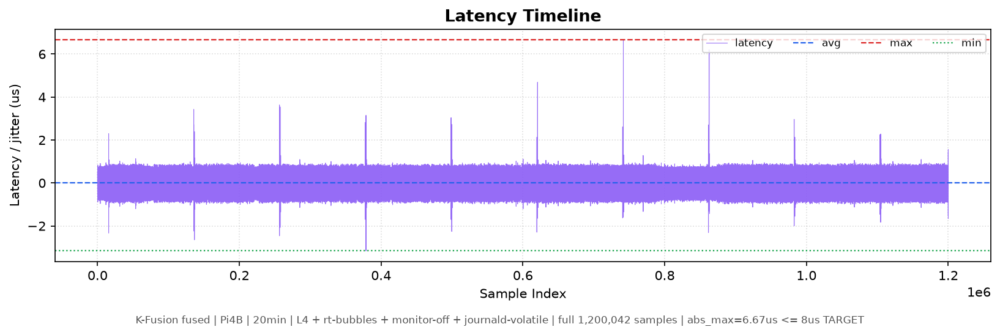

*图 K：达标轮延迟时间线。*

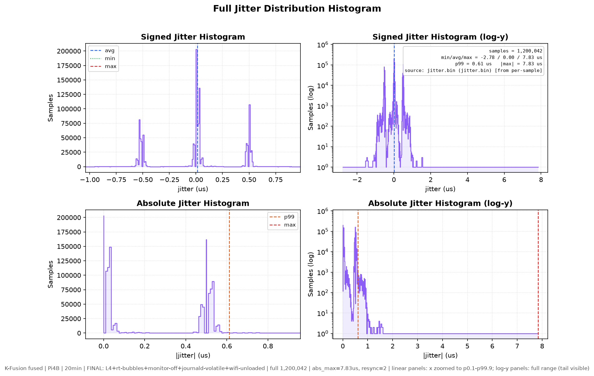

*图 L：最终轮（WiFi 运行时卸载）抖动分布。p99.99 = 0.945 µs、p99.999 = 2.000 µs。*

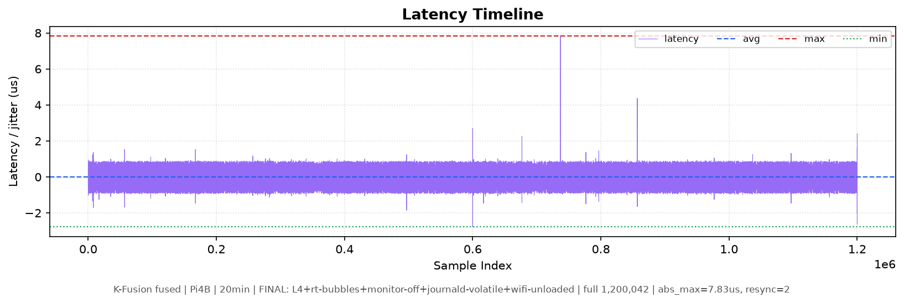

*图 M：最终轮延迟时间线。>3 µs 仅 2 次（736.8 s、856.8 s）。*

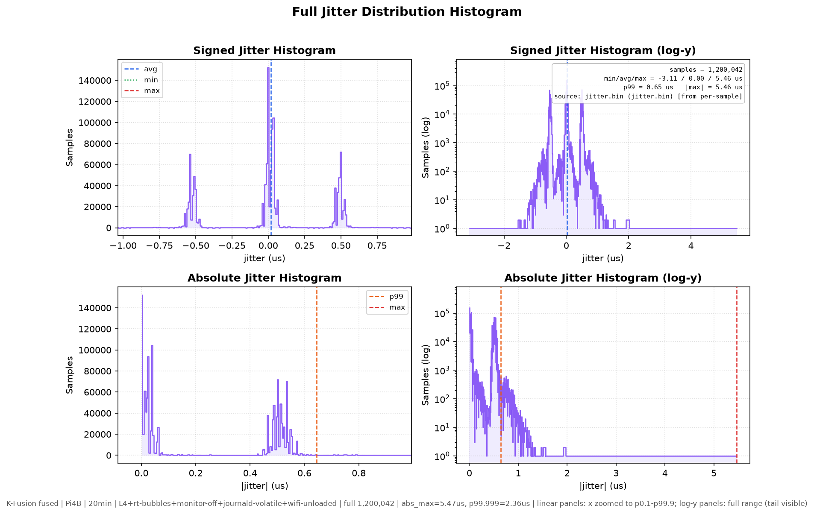

*图 N：最优 single-run（abs_max = 5.465 µs）抖动分布，p99.999 = 2.355 µs。*

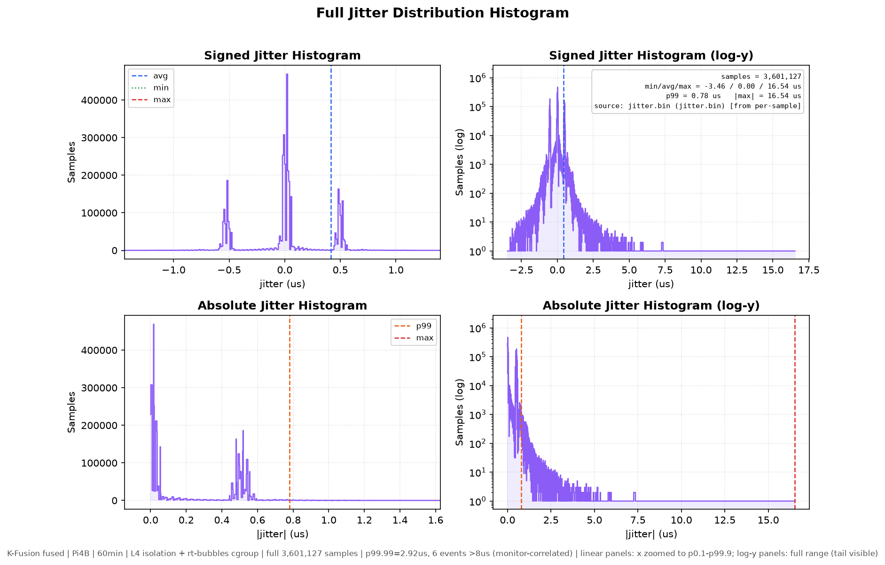

*图 H：1 h 抖动分布（全样本）。log-y 面板可见稀疏尾部（6 次 >8 µs）。*

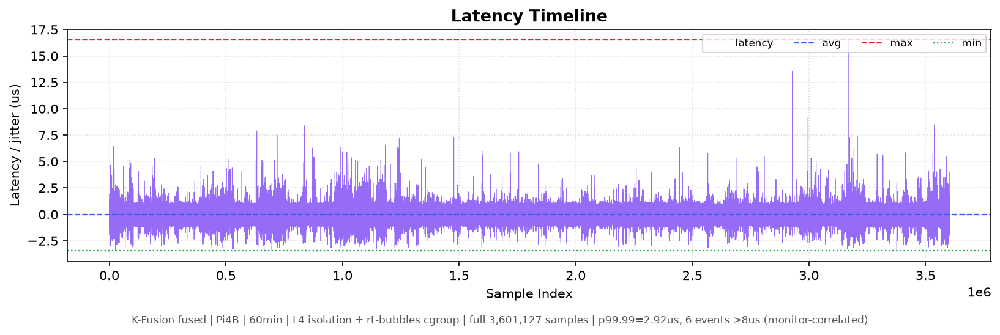

*图 I：1 h 延迟时间线（3.6 M 点）。*

## 9. xlat 全样本长跑与交叉验证（2026-10-17/18）

### 9.1 探针与口径

`xlat`（`crtos/jailhouse_overlay_pi4/nuttx/apps/examples/xlat/`）跑在 NuttX inmate（cell 独占 CPU1，
tickless，1 kHz），**全程零 printf**，样本经 Jailhouse IVSHMEM `rw_section`（`0x1faf1000`）发布，
root cell 侧 `xlat_collect` busy-poll 实时收取并落盘。它同时产出两个量：

| 量 | 时间戳 | 含义 |
|---|---|---|
| **域内抖动** | `t_wake − t_deadline`（均在 inmate 内核） | 与 cyclictest 同类，但不经用户态、不打印 |
| **跨域回传延迟** | `root 用户态读时刻 − t_publish` | 数据从 inmate 到 Linux 应用可见的端到端时延 |

**校准口径（重要）**：两域 CLOCK_MONOTONIC 起点不同，绝对延迟需校准。早期用全局最小值作零点，
但 8 h 数据暴露出**一次 50.952 ms 的负向时钟跳变**（第 26 587 s，NuttX tickless 时间补偿疑点），
全局最小值会被这一次事件拖低，导致其余样本被整体抬高 50 ms。现改用**跳变感知校准**：
按相邻样本差 >1 ms 切大段，段内再按 10 s 子段取最小值。
→ 表中**延迟分位数可比，绝对延迟不可比**；域内抖动不受此影响。

### 9.2 三档全样本结果（inmate 域内抖动）

| 方法 | 窗口 | n | min | p50 | p99.9 | p99.99 | abs_max |
|---|---|---|---|---|---|---|---|
| **cyclictest `-q`（§7，正式口径）** | **1 h** | 3 600 000 | **3.0** | 4.0（avg） | — | — | **9.0** |
| **cyclictest `-q`（§9.8，100 s 复测）** | **100 s** | 100 000 | **3.0** | 4.0（avg） | — | — | **9.0** |
| xlat 全样本（交叉验证） | 15 min | 856 064 | 4.889 | 4.908 | 4.945 | 5.111 | 6.574 |
| xlat 全样本（交叉验证） | 1 h | 3 424 256 | 5.204 | 5.259 | 5.297 | 5.463 | 7.130 |
| xlat 全样本（交叉验证） | **8 h** | **27 389 952** | 5.259 | 5.297 | 5.334 | 5.500 | **10.963** |

（单位 µs。cyclictest 为 1 µs 桶截断读数，xlat 为 ns 分辨率。）

### 9.3 与 cyclictest 的交叉验证（两支独立通路）

- **窗口相同（1 h）时**：cyclictest max **9.0 µs** vs xlat abs_max **7.130 µs** —— 同量级，
  cyclictest 略高，符合预期（它要经用户态 clock_nanosleep 回环，xlat 的唤醒路径更短）。
- **8 h 窗口**：abs_max **10.963 µs**，但**仅 1 次超过 9 µs**（p99.99 = 5.500 µs）——
  长窗口把极值抬高，**中位数几乎不动**（5.259 → 5.297）。
- **结论**：两套完全独立的测量通路（用户态 rt-tests vs 内核态共享内存探针）在 **6–11 µs** 区间
  相互印证，说明 5 µs 量级不是某一支工具的系统偏差。

> ⚠️ **引用纪律**：表内每行都标了窗口。**不得**用 8 h 的 `10.963 µs` 去除以 cRTOS 约 100 s
> 窗口的 `5 µs` 最小值来算"倍数"——窗口不同，极值不可直接比。正式对外数字仍用 §7 的
> **cyclictest `-q` 1 h / max 9 µs**（与 cRTOS 同工具、同 1 µs 桶口径）。

### 9.4 跨域回传延迟（同一批样本）

| 窗口 | n | min | p50 | p99 | p99.9 | p99.99 | abs_max |
|---|---|---|---|---|---|---|---|
| 15 min | 856 064 | 0 | **0.033** | 0.284 | 52.486 | 907.9 | 999.2 |
| 1 h | 3 424 256 | 0 | **0.037** | 0.301 | 56.148 | 903.5 | 999.0 |
| 8 h | 27 389 952 | 0 | **0.044** | 0.525 | 56.077 | 904.8 | 999.2 |

（单位 µs；min 为校准零点。）

**读法**：主体是**几十纳秒**（p50 = 33–44 ns），p99 仍亚微秒；但 p99.9 跳到 ~55 µs、
p99.99 ~905 µs，**三档 abs_max 一致地落在 999 µs**（999.2 / 999.0 / 999.2）——
那恰好是**一个 Linux 调度时间片**，属系统常数而非随机事件。

**归因**：该尾部**不由 inmate 决定**。判据有三：
(i) inmate 自身 8 h 的 abs_max 仅 10.963 µs，比 999 µs 小 91 倍；
(ii) 若尾部源自 inmate，其抖动应同步出现 ~999 µs 的异常，但没有；
(iii) 三档 max 相差 <0.2 µs，是固定时间片才有的特征。
→ 尾部来自 **root cell 侧 busy-poll 进程被 Linux 抢占**（抢占期间样本在邮箱里积压，恢复后读到的
最新样本延迟即等于积压时长）。同一机制也解释了 root 侧漏样本约 4.9 %（`n` 仅为 `1 kHz × 时长`
的 95.1 %）——**漏样本与延迟尾部是同一现象的两面**。

### 9.5 root cell 同长度基线（1 h）—— 补齐 §7 的对照缺口

> §7 已经指出：inmate 1 h vs root 15 min 时长不同，**不能直接算改善倍数**。本节补同长度。

**命令**（root cell，与 §2 的 15 min 基线同参数）：

```
cyclictest -t 1 -p 99 -i 1000 -m -a 3 -D 3600 -h 4000 --histfile=root_1h.hist -q
```

（`-m` mlockall、`-a 3` 绑 CPU3、FIFO 99、1 kHz；`-q` 只输出摘要，避免打印自扰 —— 见 §7.1。）

**结果**（`rootbase/root_1h.hist`，**3 600 000** 样本跑满，1 µs 桶，非零桶 210 个）：

| 指标 | **root cell 1 h** | root cell 15 min（§2） | inmate 1 h（§7） |
|---|---|---|---|
| 样本 | **3 600 000** | 900 000 | 3 600 000 |
| min | **12 µs** | 11 µs | 3 µs |
| avg | **20.97 µs** | 18 µs | 4 µs |
| p99 | **32 µs** | — | — |
| p99.9 | **49 µs** | — | — |
| p99.99 | **81 µs** | — | — |
| **max** | **760 µs** | 96 µs | **9 µs** |

**尾部**：≥ 50 µs 共 3 493 次（0.097 %）、≥ 100 µs 170 次（0.0047 %）、
≥ 200 µs 99 次（0.0028 %）、≥ 500 µs 46 次（0.0013 %）。

→ **同长度（1 h）对照：root 760 µs → inmate 9 µs，约 84×。** 这是本项目第一次在**同窗口、
同工具（rt-tests 系）、同 1 µs 桶**的条件下给出的改善倍数——§7 的三条口径约束中第一条
（不得跨窗口比）至此解除。

→ 同时注意 **max 随窗口显著增长**：root 15 min 为 96 µs，1 h 涨到 **760 µs**（约 8×）。
这直接证明"极值不可跨窗口比较"不是教条：同一台板子、同一参数，窗口拉长 4 倍，最大值涨 8 倍。

### 9.6 负载档（对齐 Access'25 的五档）—— 2026-10-18 实测

Access'25 的 5 µs 是**空载最小值**，其对比用的最大抖动是**带负载**的（NuttX 约 60 µs、
FreeRTOS 约 20 µs），负载分 `noload / cpu / cache / vmem / stream` 五档。
我们此前只有空载。本节在同一块 Pi4B 上补这五档。

**做法**：负载施加在 **root cell 的 CPU 0/2/3**（CFS 普通进程，`stress-ng --taskset 0,2,3`），
**不碰 CPU1**（inmate 的核）；xlat 在 inmate 内持续采集，**五档共用同一个 xlat 会话**
（cell 只启动一次），每档 900 s、858 112 样本。采集器 SCHED_FIFO 60 绑 CPU2，不会被 CFS 饿死。
负载实测全部跑满 900 s（cpu 2549 / cache 2861 / vmem 749.9 万 / stream 10.7 万 ops）。

| 档 | 负载 | n | min | p50 | p99 | p99.9 | abs_max | >9 µs |
|---|---|---|---|---|---|---|---|---|
| **noload** | 无 | 858 112 | 4.796 | **4.833** | 5.000 | 5.352 | 11.129 | 24 |
| **cpu** | `--cpu 3` | 858 112 | 4.796 | **4.833** | 4.981 | 5.148 | 8.630 | 0 |
| **cache** | `--cache 3` | 858 112 | 4.796 | **4.833** | 5.759 | 6.500 | 8.407 | 0 |
| **vmem** | `--vm 3` | 858 112 | 4.796 | **5.092** | 7.314 | 8.574 | 11.500 | 405 |
| **stream** | `--stream 3` | 858 112 | 4.796 | **6.296** | 8.629 | 9.018 | 11.129 | 956 |

（单位 µs。）

**四条可直接写进论文的结论**：

1. **最小值完全不受负载影响**：五档 `min` **全部为 4.796 µs**（一字不差）——
   最佳唤醒路径由 inmate 自身决定，root cell 的负载动不了它。
2. **CPU 负载零影响**：`p99` 甚至略低于空载（4.981 vs 5.000），差异在噪声内。
   即"邻居核在算数"不会干扰 inmate 的定时。
3. **干扰按"共享资源类型"分级**：cache（p99 +15 %）< vmem（+46 %）< **stream（+73 %）**；
   `p50` 也同步从 4.833 抬到 6.296（+30 %）。**瓶颈在内存子系统（L2/L3/内存控制器），
   不在 CPU 时间片**——这与 hypervisor 只能隔离"核与中断"、无法隔离"共享缓存与内存带宽"
   的架构事实完全吻合。
4. **最坏值不随负载系统性地变差**：abs_max 在 8.407–11.500 µs 之间波动，**没有单调趋势**，
   空载的 11.129 甚至高于 cpu 档的 8.630。→ 极值由**单发事件**主导，持续负载抬的是**中位数与
   分位数**，两者不是同一回事。

> ⚠️ 与 cRTOS 的带负载数字**不可直接比优劣**：他们的负载是"在 side-by-side Linux 上跑
> stress-ng 的 cpu/cache/vmem/stream"（可能多 stressor 并发），我们为控制变量而**按单 stressor
> 顺序施加**，强度未逐项对齐。该行只作**量级参考**（11 µs 级 vs 其 20/60 µs 级）。

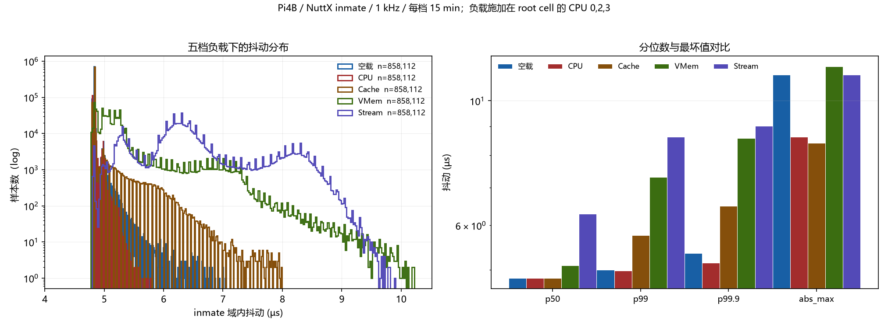

*图 O：五档负载对比。左为分布叠加（log-y），右为 p50/p99/p99.9/abs_max 柱状图（log 轴）。*

### 9.7 ⚠ 会话级基线差异：min 不是常数，但会话内恒定

§9.2 里 15 min 的 min 是 4.889 µs，1 h 是 5.204，8 h 是 5.259，看起来像"跑得越久地板越高"。
实测否定了这个解释：

| cell 会话（各次重启） | 该会话的 min | 备注 |
|---|---|---|
| 2026-10-17 15:14 UTC | 4.889 µs | 15 min 档 |
| 2026-10-17 15:35 UTC | 5.204 µs | 1 h 档 |
| 2026-10-17 16:36 UTC | 5.259 µs | 8 h 档 |
| **2026-10-18 10:41 UTC** | **4.796 µs** | 五档全部（5 × 15 min，共 429 万样本） |

**判据**：10-18 这一次会话跑了 75 分钟、429 万样本，五个 15 min 子窗口的 min **一模一样都是
4.796 µs**——如果地板随运行时长抬升，这里应该看到单调上升，但没有。
反过来，4.796 / 4.889 / 5.204 / 5.259 这些差异**只出现在重启 cell 之间**。

**已排除的因素**：
- **同一份 nuttx.bin**：`sha256 aee7fb08e6a08026fd262daf58418690ea0ae6a61c74444a3d5899a8cdafacfc`，
  10-17 15:14 UTC 之后未再编译；
- **tickless 仍开启**：`CONFIG_SCHED_TICKLESS=y`、`TICKLESS_ALARM=y`、`LIMIT_MAX_SLEEP=y`、`USEC_PER_TICK=1`；
- **频率未变**：该内核对无 `cpufreq` 节点，BogoMIPS 恒为 108 → Pi4 默认 **1.5 GHz** 固定档。

**结论**：基线在**每次 cell 启动时**由加载/初始化路径决定（tickless 补偿相位、物理页与 cache
映射布局等），量级 **0.3–0.5 µs（6–10 %）**。因此——

> **同一 cell 会话内的比较（如 §9.6 五档之间）严格可比；跨会话的绝对值不可直接比，
> 跨会话比较只能看趋势与量级。**

这条与 §7 的"窗口不可跨比"是两条独立的引用纪律：**一条管时间窗，一条管会话**。

### 9.8 100 s 短窗复测：用论文同一把尺子替换早期 rtlat 口径（2026-10-19）

**动因**：§6 的 inmate 值是自写 `rtlat` 在 15 min 下的结果，而早期版本有两处缺陷——延迟
**整数截断到 µs**（"全是 5"只代表落在 `[5,6) µs`）、且把**提前唤醒截断为 0**。
用它去和 cRTOS/论文的 cyclictest 数字并列，尺子不是同一把。

**做法**：在与论文同口径的 **cyclictest（NuttX 移植版）**上重测，命令与 §7 完全一致，
仅把次数从 360 万降到 10 万（100 s）：

```
cyclictest -n 0 -m 0 -q -p 200 -h 200 -l 100000 -i 1000
```

- **`-q` 必须保留**：同一参数下若打印状态行，最大抖动会从 **9 µs 抬到 64 µs**（§7.1 的 A/B 已证）；
- 经 **USB-TTL（GPIO 14/15，115200 8N1）** 在 NSH 里执行 —— `jailhouse console` 看不到 inmate 输出；
- 环境：cell 独占 CPU1、tickless、root cell 空闲。

**结果**（`crtos/results/raw/pi4_inmate_cyclictest_100s_q.log`，208 行含 200 桶直方图）：

| 指标 | 值 |
|---|---|
| Total | **100 000**（跑满 100 s） |
| Min / Avg / **Max** | **3 / 4 / 9 µs** |
| Overflows（>200 µs） | **0** |

非零桶（1 µs 桶）：3 µs ×1、4 µs ×**1 283**、5 µs ×**98 714**（98.7 %）、6 µs ×1、9 µs ×1；
**8 µs 桶为 0，10 µs 以上完全没有**。

**与 §7 的 1 h 互证**：两个相差 **36 倍**的窗口给出**同一个 Max = 9 µs**，且分布形状一致
（5 µs 为绝对主体，95.3 % vs 98.7 %）。这比"同窗口重复两次"更强——9 µs 是该配置的稳定上界，
不是某个窗口的偶发。

> ⚠️ 概率必须一起报：9 µs 在 1 h 内出现 47 次（0.0013 %），在 100 s 内只出现 1 次（0.001 %）。
> 只写"max 9 µs"而不写窗口与概率，会让读者误以为 100 s 就能稳定复现 1 h 的极值。

**替换关系**：

| 项 | 旧（早期 rtlat 15 min） | 新（本小节） |
|---|---|---|
| Min/Avg/Max | 5 / 5 / 5 µs（截断假象） | **3 / 4 / 9 µs** |
| 分辨率 | 整数 µs | 1 µs 桶（工具固有）+ 记录了 3 µs 快路径 |
| 负值 | 截断为 0 | 记带符号值 |
| 引用状态 | **作废**（`PI4_CODE_PROBE`、`PI4_CRTOS实验方案`、`README__Jailhouse` 三处已改） | **正式口径** |

同时**撤回**早期"同板改善 19.2×（96→5 µs）"的说法：96 µs 是 root 的 **15 min**、5 µs 是**截断假象**，
属跨窗口 + 截断值双重误算。正确的同长度（1 h）改善为 **760 / 9 ≈ 84×**（§9.5）。

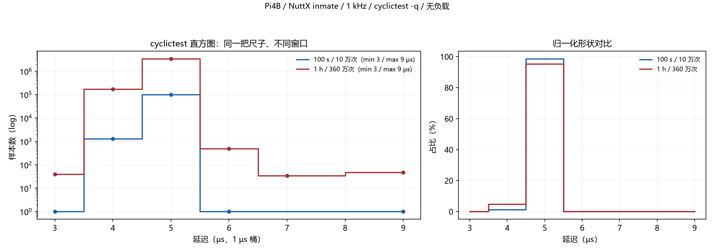

*图 P：左为绝对样本数（log-y），右为归一化占比。两条曲线形状几乎重合，`min 3 / max 9 µs` 一致；
1 h 在 6–9 µs 尾部有更多样本（样本量 36 倍），但主体（5 µs）占比几乎不变（98.7 % vs 95.3 %）。*

完整摘要另存：`crtos/results/INMATE_CYCLICTEST_100S__inmate100秒正式口径.md`
