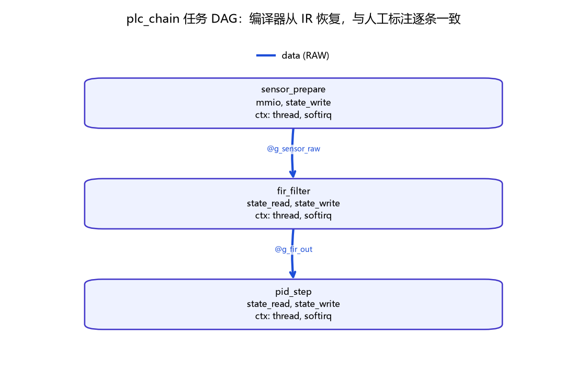
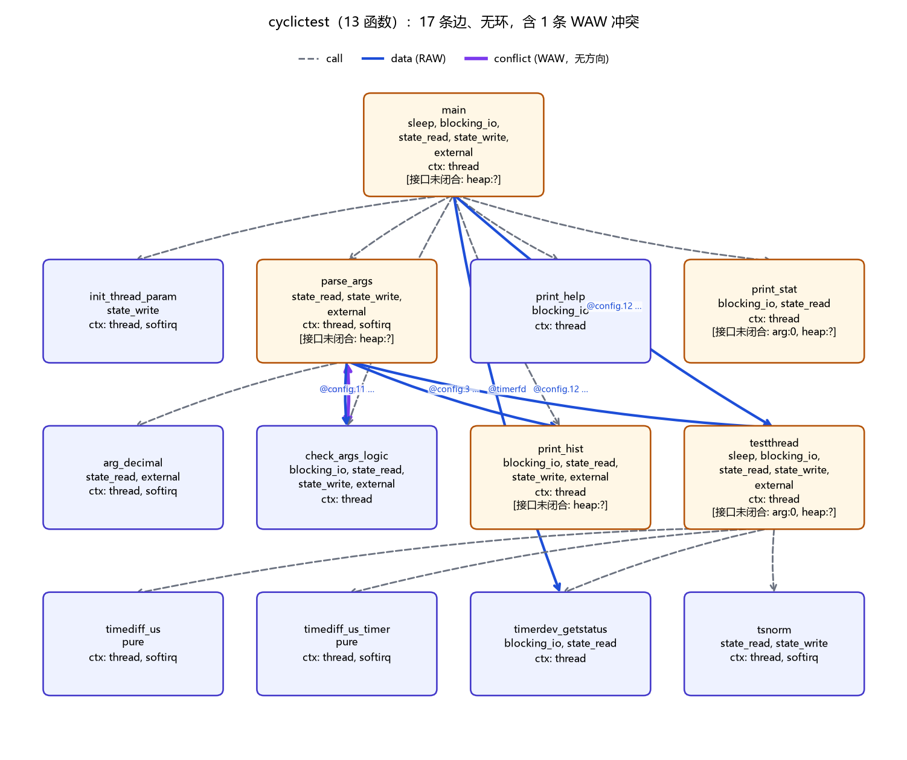

# 任务 DAG 生成（ECoS PR 3）

> 状态：**已实现并实测**（2026-10-23）· 平台 Pi4B + LLVM 16.0.6
> 入口：`kfusion/scripts/dag_build__任务DAG生成.py`
> 上游：`EffectSummaryAnalysis`（`plc-effect-summary`，输出 v22 含 `interface_bindings`）
> 自测：`kfusion/scripts/test/dag_selftest__自测.sh` → **16/16**
> 相关：`ANALYSIS__效果摘要分析.md`（函数级摘要）、`CONTRACT__任务契约与校验.md`（输入门禁）

---

## 1. 为什么需要这一步

`EffectSummaryAnalysis` 回答的是**函数级**问题：「这个函数会读/写哪些区域、会不会睡、会不会碰 MMIO」。
但 ECoS 的优化对象是**任务级**的：哪个阶段必须在哪个之前、哪些可以并行或融合。

中间缺的这一层，就是**任务 DAG**。而且它比前两步更危险：

> 效果摘要错一条，是"某个阶段被判成能放/不能放"；
> 依赖图错一条边，是"求解器把有依赖的两段判成可重排"——**那是正确性问题，不是精度问题**。

所以本文档的重点不是"我们连出了多少条边"，而是**每条边的语义与可证性**。

---

## 2. 边的语义（方向性不同，绝不能混）

| kind | 条件 | 约束 | 可证性 |
|---|---|---|---|
| `call` | A（传递地）调用 B | A 在 B 之前 | 可证 |
| `spawn` | A 用 `pthread_create` 启动 B | A 在 B 的首次执行之前 | 可证 |
| `data` | A 写 r，B 读 r（RAW） | A 在 B 之前 | 可证（r 须为模块级具体区域） |
| `anti` | A 读 r，B 写 r（WAR） | A 在 B 之前 | 可证；**已有反向 RAW 时不再重复** |
| `conflict` | A 写 r，B 也写 r（WAW） | **无方向**：只禁止重排/融合 | 可证 |
| `candidate` | 区域只到 `arg:N`（多绑定） | 不详 | **未证明**，不得当依赖 |

`conflict` 单独一类是关键：两条有向边同时画 a→b 与 b→a，读图的人会以为存在环，而实际是"谁先谁后自由，但两者不能合并、不能调换"。

`spawn` 也必须单列，不能并进 `call`：`pthread_create(tid, attr, entry, arg)` 是把 `entry`
交给库/内核去**起**，调用图里根本没有这条边（`main` 的 `calls` 里没有 `testthread`），
而且"创建即执行"与"直接调用"的时序语义不同。本项目里跨域任务就是线程，
这条关系必须显式建模——否则最该关心的一类依赖恰好是盲区。

---

## 3. 三个必须处理的陷阱（都有反证）

### 陷阱 1：WAR 与反向 RAW 是同一个约束

`fir_filter` 读 `@g_sensor_raw`、`sensor_prepare` 写它。按集合硬算会同时得到：

```
sensor_prepare → fir_filter   [RAW]   @g_sensor_raw
fir_filter     → sensor_prepare [WAR] @g_sensor_raw     ← 假环
```

但在"每周期顺序执行"的语义下，那个读**就是**消费这次写，不是第二条独立约束。
第一次跑示例时就出了这两条边（`data 2 / anti 2`），拓扑序虽然还对，但图上是个环。

**规范**：已有反向 RAW 时不出 WAR。

### 陷阱 2：WAW 无方向

两个阶段都写同一区域 → 不能重排、不能融合，但**谁先谁后是自由的**。
若按有向边同时画 a→b 与 b→a，必然报假环。

**规范**：WAW 出**一条无向 `conflict`**，不参与拓扑排序（DOT 里用 `dir=none`）。

### 陷阱 3：调用者/被调者之间不生成数据边

摘要里调用者的 reads/writes **包含**它所有被调函数的效果（跨过程传播的结果）。
于是 `chain_main` 会"写" `@g_sensor_raw`（因为 `sensor_prepare` 写它），
而 `sensor_prepare` 又"读"它 —— 按区域名硬连边必然双向成环。

**规范**：若 A 传递调用 B，A/B 之间只保留 `call` 边，数据重叠记 `explained_by_call`。

### 反证：`--naive` 关掉全部抑制

只说"我们做了三条抑制"没有说服力，得证明它们**不是空转**：

```
$ dag_build … caller_trap.summary.json --naive --fail-on-cycle
  callee -> caller  [anti] @g_x
  callee -> caller  [data] @g_x
  caller -> callee  [anti] @g_x
  caller -> callee  [call] callee()
  caller -> callee  [data] @g_x
拓扑序:（有环，不可用）      环: callee -> caller -> callee      rc=4
```

同一份数据，正常模式只有 1 条 `call` 边、无环；`--naive` 立刻成环。
这条反证写进了自测（第 3 项），以后改代码若把抑制改坏，用例会红。

---

## 4. 接口闭合：把 `arg:N` 变成真名

`arg:N` 是**函数局部**名字：`fir_filter` 的 `arg:0` 与 `pid_step` 的 `arg:0` 是两个不相干的对象。
直接按名字配对会造出大量假边。闭接口就是把它换成模块级真名，并明确"换不出来时是什么情况"。

### 4.1 三个信息源，可靠性从高到低

| 来源 | 内容 | 能不能递归 |
|---|---|---|
| `callsites` | 谁、在哪个调用点、每个实参是什么区域 | **能**（实参本身是上层的 `arg:K` 时继续往上解）|
| `thread_entries` | `pthread_create` 的 `(entry, arg)`：entry 的 `arg:0` 就是那个 `arg` | 能（arg 也可能是上层的 `arg:K`）|
| `interface_bindings` | 形参 → 全部调用点区域的聚合 | 不能（丢了调用者身份，只知道"有几种"）|

前两个是 pass v23 新增的。聚合视图单独存在时会丢信息：遇到 `arg:1` 这种相对名，
不知道是**哪个**调用者传的，就没法再往上走一层。

递归解析 `b_core` 的 `arg:0` 的实际路径：

```
b_core  arg:0  ← b_wrap 调用点传的是 arg:0（b_wrap 自己的形参）
               ← top   调用点传的是 @g_x
        ⇒ @g_x                                   （两跳，聚合视图做不到）
```

深度上限 4，且带 `(函数, 区域)` 的已访问集合防环。**只要有一个入口解不出来就整体放弃**
（返回 `none`），不允许"部分正确"——半对的区域名比没有更危险。

### 4.2 解析结果三态

| 级别 | 条件 | 处理 |
|---|---|---|
| **proven** | 所有入口都解到同一个具体区域 | 落地成真名，可连 `data` |
| **alternatives** | 解出多个不同区域 | 真信息但不确定这一拍走哪条 → `candidate` |
| **unresolved** | 解不出（未被调用 / 相对名 / `heap:?`） | **零信息**，不造边，节点标 `interface_unresolved` |

第三级最容易搞错。两个函数都带未解析的 `arg:0`，**同名不代表任何别名关系**——
为它造边是纯噪声；但"不造边"也不能被读成"没有依赖"。
所以必须在图上显式标出"接口未闭合"，让读图的人知道**这里的信息是缺失的，不是零**。

> 实现时踩过一个坑：备选区域内部存成 `alt:@buf_x` 以便区分，但比较前忘了剥前缀，
> 结果与已证名永远配不上，候选边被**静默丢弃**。静默丢边比多一条噪声边危险得多。

## 5. 实测

### 5.1 示例 `plc_chain`：与人工标注逐条一致

```
$ bash kfusion/scripts/ecos_demo__效果摘要端到端.sh      # 第 6 步
== 边 ==
  sensor_prepare -> fir_filter   [data] @g_sensor_raw
  fir_filter     -> pid_step     [data] @g_fir_out
== 拓扑序 ==
  sensor_prepare -> fir_filter -> pid_step
== 与人工图对照 ==
  人工 2 条 / 编译器 2 条 / 命中 2
  precision 1.000  recall 1.000  f1 1.000
  ✅ 与人工拓扑完全一致
```



> 图：`kfusion/docs/figures/dag/plc_chain_dag.png`
> 数据：`scripts/test/dag/plc_chain.summary.json`（板上 Pass 的真实输出，v22）
> 画图：`scripts/dag_plot__DAG绘图.py`（纯 matplotlib，不需要 graphviz）

人工图来自 `contracts/examples/plc_chain.stages.json` 的 `depends_on`
（`sensor_prepare → fir_filter → pid_step`）——**编译器是从 IR 把同一张图推出来的**，
不是读那份 json 抄的（`depends_on` 字段只用于对照，不参与构图）。

### 5.2 真实产物 `cyclictest`（13 函数，`-O1 -fno-inline`）

| 指标 | 值 |
|---|---|
| 节点 | 13 |
| 边 | 17（call 11 / **spawn 1** / data 4 / conflict 1） |
| 候选 | 0 |
| 环 | 无 |
| 区域：唯一绑定 / 多绑定 / 未解析 | **6** / 0 / **7**（v22 时是 5 / 0 / 8）|
| `callsites` / `thread_entries` | 25 条 / 1 条（`main → testthread`）|

拓扑序：

```
main → init_thread_param → parse_args → arg_decimal → check_args_logic
     → print_help → print_hist → print_stat → testthread
     → timediff_us → timediff_us_timer → timerdev_getstatus → tsnorm
```



> 图：`kfusion/docs/figures/dag/cyclictest_dag.png`（橙色框 = 接口未闭合的节点）
> 数据：`figures/dag/cyclictest.dag.json`　画图：`dag_plot__DAG绘图.py`

**手审两例**（对着源码看，不是只看统计）：

1. `parse_args → check_args_logic [data] @config.11,.12,.13,.7,.9`
   且 `check_args_logic ↔ parse_args [conflict] @config.7,.9`
   —— `parse_args` 解析命令行写 `config`，`check_args_logic` 读它并**回写**部分字段。
   两条边落在**不同字段**上（RAW 在 .11/.12/.13，WAW 在 .7/.9），可以并存。
   这正是"同一对节点可以有多种约束"的例子。

2. `main → testthread [spawn] pthread_create(testthread)`
   —— `testthread` 不在 `main.calls` 里（它是 `pthread_create` 的函数指针参数）。
   v22 只能靠数据边"猜"到这条依赖（`main` 写 `@config.*`、线程读）；
   v23 由 `thread_entries` 直接给出，并升级成语义正确的 `spawn`。
   同时 `testthread` 的 `arg:0` 被绑到 `heap:malloc#5`（创建时传入的那个结构体），
   所以它不再出现在 `interface_unresolved` 里。

   → 教训：**只靠调用图会漏掉跨线程依赖**，而这类依赖恰恰是本项目最关心的。
   顺带说明数据边不是调用图的冗余装饰——在 v22 里它是唯一的补救手段。

### 5.3 接口闭合的收益与剩余缺口

先弄清 `heap:?` 到底是什么（pass 的 `PLC_EFFECT_SUMMARY_WHY=1` 会打印产生点）：

| 产生方式 | 条数 |
|---|---|
| 经内存 `load ptr, ptr` 得到的指针（如 `par->hist`）| **31** |
| 外部调用返回的指针（全部是 `getoptargp()` / `getoptindp()`）| **18** |
| `phi ptr` 合流 | **2** |
| 合计（区域**出现次数**，去重后是 7 个不同名字）| **51** |

按函数：`parse_args` 28（几乎都是 `getoptargp` 及其 load）、`print_hist` 15、`main` 5、
`testthread` 2、`print_stat` 1。

本轮的闭合只做了**模块内可证**的那两类：

| 机制 | 效果 |
|---|---|
| 递归 `callsites` | `arg:N` 可跨多层解析（构造用例 `b_core.arg:0 → @g_x` 两跳）|
| `thread_entries` | `testthread.arg:0 → heap:malloc#5`；`main→testthread` 升级为 `spawn` |
| 净效果 | 唯一绑定 5 → **6**，未解析 8 → **7**，边数不变但边类型更准（data → spawn）|

**剩余 7 个未闭合区域，缺口是明确的，不是含糊的**：

1. **经内存读出的指针**（31 条）——需要 points-to / field-sensitive 分析。
   我们只有"根对象"级别的划分，`par->hist` 这种"结构体字段指向另一块内存"跨不过去。
2. **外部函数返回的指针**（18 条）——需要**API 指针摘要**（如 `getoptargp() → 静态缓冲区`）。
   这跟 `kKeep` 白名单是同一类知识：由人声明，不靠分析猜。
3. **PHI 合流**（2 条）——需要路径敏感或至少值集分析。

> 注意：这 7 个未闭合区域都落在 `main`、`parse_args`、`print_hist`、`print_stat`、`testthread`
> 五个节点上，而它们相对 `main` 的顺序已由 `call`/`spawn` 边定死。
> 未判定的是**兄弟节点之间**的顺序（例如 `print_hist` 与 `testthread`）——
> 这恰好是最可能被并行/融合的部分。所以这是**真缺口**，不能因为"它们都是 main 的子节点"
> 就当作无害。

---

## 6. 环的处理：分为「延迟反馈环」与「代数环」

旧版一见环就报错。但采样控制回路**本来就是环**——执行器写出去，下一拍传感器才读回来。
把这种环一棍子打死，等于宣布"规划器不支持控制回路"，那是不可接受的。
v2 把环分成两类，判据只有一条：**环里有没有一条"相位反向"的边**。

| | 条件 | 含义 | 处理 |
|---|---|---|---|
| 延迟反馈环 | 环内存在边 `u→v`，相位 `u` > 相位 `v` | 该边在一拍内**不可能**满足，只能读上一拍 ⇒ 就是 z⁻¹ | 合法，延迟 1 拍 |
| 代数环 | 环内每条边相位都不晚于消费者 | 所有边都要求"同一拍内先写后读"，首尾相接 ⇒ 无合法顺序 | 拒绝（rc=5） |
| 相位未知 | 函数视图，或骨架没给 `offset_us`/`step_us` | 无法证明环跨了拍边界 | 按代数环处理（fail-closed） |

**为什么不猜**：把代数环误判成反馈环，板上会算出与设计不符的值，而图上完全看不出来。
所以没有相位信息时一律当非法环——"看起来像反馈环"不是证据。

### 6.1 同一张摘要，两个判决

`true_cycle`（p 写 `@x` 读 `@y`；q 写 `@y` 读 `@x`）跑两遍：

```text
$ dag_build true_cycle.summary.json                                  # 函数视图，无相位
== ⛔ 代数环 1 个（拍内闭合，无合法执行顺序）==
  环：p -> q
    无相位信息（函数视图或骨架未给 offset_us/step_us）→ 无法证明环跨越了拍边界，按 fail-closed 判代数环
  → rc = 5（--fail-on-algebraic）

$ dag_build true_cycle.summary.json --stages true_cycle.stages.json  # p@0µs, q@200µs
== ↻ 延迟反馈环 1 个（合法：延迟由调度强制为 1 拍）==
  环：p -> q
    闭合边 q→p：相位 200→0 µs，未融合时间隔 800 µs
      证据：@y
  摘掉延迟边后的相位序：p -> q
  → rc = 0
```

同一个 `p↔q`，**加了相位就变成合法回路**。这不是放宽标准，是把"什么时候这个环
物理上可实现"这件事说清楚：`q` 在 200 µs 写，`p` 在下一拍 0 µs 读，间隔 800 µs
（`period − (phase_q − phase_p)`），一拍之内根本不可能满足，所以它必然是 z⁻¹。

### 6.2 输出字段

- `recurrences[]`：`ring`（按相位排序的环成员）、`closing_edges[]`
  （`phase_from` / `phase_to` / `delay_periods` / `delay_us_unmerged`）、`why`。
- `algebraic_loops[]`：`ring` + `why`（哪一条原因判它是拍内闭合）。
- `topo_order_delayed`：**摘掉所有闭合边之后**的拓扑序，且按相位出堆 ⇒ 对环而言
  它就是真实的释放顺序。规划器用它；`topo_order` 在有环时仍为空（严格模式不变）。
- `phase`：`{known, unit, period_us, offsets{阶段: µs}}`。
- 退出码：`--fail-on-cycle` 仍拦任意环（rc=4，严格模式）；`--fail-on-algebraic`
  只拦代数环（rc=5）。两者可同时用。

DOT 图里闭合边画成**红色粗线 + `z⁻¹` 标签**，节点上标出相位（`t=200µs`），
环一眼能看出来断在哪。

---

## 7. 明确不主张

1. **区域名只在同一次分析内可比**。`heap:malloc#N` 的 `N` 是模块级单调计数，
   换编译选项、换 module 都会变；跨 module 合并摘要时 heap 名会**假重叠**（尚未处理）。
2. **数据边含传播冗余**。A、B 都调用同一个写者时，会得到 A↔B 的边——方向正确
   （由 A→writer→reader→B 传递可得），但不是最简图。只影响图的可读性，不影响拓扑序。
3. **非流敏感**。只区分"这个函数可能读/写 r"，不区分条件分支；
   一个只在 `if (rare)` 里写的区域，照样算写。
4. **跨周期只在"相位已知"时才判**。第 k 拍与第 k+1 拍之间的依赖靠**相位反向**识别，
   这要求骨架给出 `offset_us` 或 `step_us`。函数视图没有相位，那里的环一律算代数环——
   这是保守，不是准确。相位本身是**人工输入的设计事实**（每阶段在一拍内的释放时刻），
   分析不去猜它。
5. **`conflict` 只表达"不可重排"**，拓扑序里这两种节点的先后是任意的，
   不能当成执行建议。
6. **未闭合的接口是真缺口**。`cyclictest` 仍有 5 个节点带 `interface_unresolved`
   （`heap:?` 及 `print_stat` 的 `arg:0`），跨阶段依赖**未判定**，不是"没有依赖"。
   缺口分类见 §5.3：内存 load 31 条 / 外部 API 18 条 / PHI 2 条。
7. **`callsites` 假设闭世界**：只统计本模块内的调用点。若某函数还会被模块外的代码调用，
   它的"唯一绑定"就可能不唯一，而分析看不见。当前只在单模块（cyclictest / plc_chain）上验证。

---

## 8. 复现

```bash
# 单跑（Pi4 上）
cd /root/K-Fusion/kfusion
python3 scripts/dag_build__任务DAG生成.py \
    analysis/build/ecos_demo/effect_summary.json \
    --stages contracts/examples/plc_chain.stages.json \
    --expect "sensor_prepare->fir_filter,fir_filter->pid_step" \
    --fail-on-mismatch --dot /tmp/plc_chain.dot

# 跨周期：同一张摘要，给相位 / 不给相位
python3 scripts/dag_build__任务DAG生成.py scripts/test/dag/true_cycle.summary.json \
    --fail-on-algebraic                                    # → 代数环，rc=5
python3 scripts/dag_build__任务DAG生成.py scripts/test/dag/true_cycle.summary.json \
    --stages scripts/test/dag/true_cycle.stages.json \
    --fail-on-algebraic --dot /tmp/loop.dot                 # → 反馈环，rc=0

# 全流程（C → IR → 摘要 → 契约 → 门禁 → DAG → 对照）
bash scripts/ecos_demo__效果摘要端到端.sh

# 回归（Windows 下传解释器绝对路径）
bash scripts/test/dag_selftest__自测.sh python3
```

自测覆盖：示例对照、陷阱 1/2/3、`--naive` 反证、真环检出、三级具体化、
递归两跳解析、线程入口绑定（`spawn` ≠ `call`）、
跨周期二分（同一摘要：无相位 → rc=5 / 有相位 → rc=0，并算出 800 µs 闭合间隔）、
DOT 的 `z⁻¹` 标注、退出码契约（3=与人工图不符 / 4=有环 / 5=代数环）、DOT 产物。**29/29**。

---

## 9. 下一步（PR 4 的输入）

DAG 已经能给出"谁在谁之前"和"谁不能和谁合并"，够 `FusionPlanner` 开始工作了。
单域融合的第一版只需要三个输入：

1. 本文件的 `edges`（顺序约束）+ `conflict`（禁止合并）；
2. 每个节点的 `effects`（能否进目标域）；
3. 每个节点的 `exec` 实测（融合的收益估计）。

接口闭合已经做完**模块内可证**的那部分（递归 `callsites` + `thread_entries`，
见 §4），剩下的缺口是分类明确的：

| 缺口 | 条数 | 需要什么 |
|---|---|---|
| 经内存 load 得到的指针 | 31 | points-to / field-sensitive |
| 外部 API 返回的指针 | 18 | API 指针摘要（人声明，如 `getoptargp() → 静态缓冲`）|
| `phi` 合流 | 2 | 路径敏感或值集分析 |

**跨周期依赖**仍未建模：第 k 拍与第 k+1 拍之间的关系（真正的反馈回路）不在图里。
这一项对融合决策影响最大——没有它，`pid_step → sensor_prepare` 这种反馈环
在图上根本看不见，会让人误以为整条链可以任意切分。

所以进 PR 4 之前要想清楚一件事：第一版融合**只在拍内**做
（把同一拍的几个阶段合并/换域），跨拍的反馈环一律不碰。这样 `FusionPlanner`
的搜索空间是合法的，而不是建立在"图上没有环"这个假前提上。
