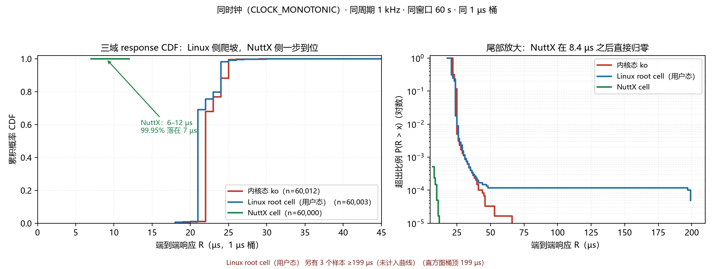

# 三域统一探针结果（r/s/f v1）：内核宿主那一格终于填上了

> 日期：2026-10-23 · 平台：Raspberry Pi 4B (BCM2711, Cortex-A72 ×4 @1.5 GHz)
> 契约：`PROBE_CONTRACT__统一测量契约.md`（r_k / s_k / f_k → start_lat / exec / response / miss）
> 解析器：`crtos/scripts/pi4/probe_report__统一探针报告.py`
> 原始日志：`crtos/results/raw/rsf/`（`kernel_host_k{1,2,3}.log`、`rsf_L{1,2,3}.log`、`bm2_nuttx_60000_*.log`）

---

## 0. 为什么这一格重要

在此之前，项目里只有 **BM2（用户态）** 和 **NuttX cell** 能给出端到端响应 R；
Linux **内核态**宿主只能给「间隔偏差」，因为 `FUSED_WAKE_TIMERTHREAD` 默认 0，
连测量线程都不唤醒。三域里缺一格，`J(θ)` 的成本模型就一直少一条腿。

本节补上这一格，并且是**同一指标、同一周期、同一窗口**。

---

## 1. 条件（三域严格对齐）

| 项 | 值 |
|---|---|
| 周期 | 1 ms（1 kHz） |
| 窗口 | 60 s × 3 轮 |
| 时钟 | `CLOCK_MONOTONIC` |
| 负载 | 同一份 rt-tests `cyclictest` 源（内核化后 vs 用户态 vs NuttX 内建） |
| 无线 | **eth0 有线**（`192.168.1.3`），wlan0 不参与 → SDIO 中断不落 CPU3 |

三域的实现差异（必须承认）：

| 域 | 实现 | 调度/落核 |
|---|---|---|
| **K**（内核态） | `official_cycletest_mod.ko`：cyclictest 经 K-Fusion 内核化 + 宿主 hrtimer 驱动 | `SCHED_FIFO 99`，绑 CPU3 |
| **B**（Linux root cell 用户态） | `bm2pid_diag`（同项目 BM2） | `SCHED_FIFO 99`，`taskset -c 3` |
| **C**（NuttX cell） | `bm2pid`（NuttX 内建） | 单核独占（CPU1），无抢占 |

> ⚠️ K 与 B 的**被测代码不是同一份**（cyclictest vs BM2 三轴 PID）。
> 所以本表只能比**同一指标的分布形状**，不能把 K/B 的差归因给"内核态 vs 用户态"。
> 真正的单变量（同代码跨域）仍只有 B vs C 那一组（BM2 两域同源）。

---

## 2. 结果（3 轮重复）

### 2.1 内核态宿主（K）

| 轮 | start_lat p50 / max | exec avg / max | **response p50 / p99 / p99.9 / max** | miss |
|---|---|---|---|---|
| k1 | 20 / 99.5 | 1.82 / 5.67 | **22 / 25 / 32 / 101.6** | 0/60013 |
| k2 | 20 / **677.6** | 1.85 / 5.13 | **22 / 26 / 33 / 679.8** | 0/60012 |
| k3 | 20 / 61.9 | 1.84 / 4.94 | **22 / 25 / 29 / 64.7** | 0/60012 |

`start_lat p50 = 20 µs` 三轮完全一致，且与 2026-10-22 记录的 root cell p50 = 20 µs **逐位吻合** —— 说明内核化没有改变唤醒路径的口径。

k2 出现 **2 个 677 µs 的尖峰**（`over=2`，超出 199 µs 桶顶）。这是真实观测，不剔除：
分位数完全不受影响（p99.99 仍是 41），但极值从 ~100 µs 跳到 680 µs。**这正是"极值不可跨窗口/跨轮次比"的又一例证。**

### 2.2 三域并列（同指标）

| 指标 | K 内核态 | B Linux root cell 用户态 | C NuttX cell |
|---|---|---|---|
| `start_lat` p50 | **20 µs** | **20 µs** | **6 µs** |
| `exec` avg | 1.82 µs | 1.20 µs | 1.12 µs |
| `response` p50 | **22 µs** | **21 µs** | **7 µs** |
| `response` p99 | 25 | 24 | 7 |
| `response` p99.9 | 32 | 34 | 7 |
| `response` p99.99 | 41–43 | 46 | 7 |
| `response` max | 65–680 | 76 | 8.4 |
| **deadline miss** | **0/60012** | **0/60000** | **0/60000** |

### 2.3 三条读数

**① 内核态与用户态在同一 hypervisor 下几乎等价（22 vs 21 µs）。**
两者都在 root cell、都是 CPU3 + FIFO99。差别只出现在 `exec`（1.82 vs 1.20，+52%），
那是内核化后计算路径更长（定点 Q 格式 + 桩层），**不是抖动变大**。
→ 支持一个弱结论：**把任务搬进内核态本身不改善唤醒延迟**，改善来自「离开 Linux 调度域」。

**② NuttX 的响应分布是一个点，不是一个分布。**
`response` 从 min 7.110 到 max 8.426，p99.99 = 7 —— 全部分位都是 7。
对比 Linux 两域的 p50→p99.99 从 22 爬到 43（近 2×），NuttX 全程平。
→ 这比"中位数快 3 倍"更有信息量：**Linux 侧的成本是重尾分布，NuttX 侧接近确定性。**

**③ 三域 miss 全为 0。**
当前利用率（exec/period ≈ 0.1–0.2%）下，没有任何一域错过期限。
→ 瓶颈不是"能不能按时完成"，而是"响应的一致性有多好"。
这是 ECoS 该优化 `Q₀.₉₉₉(R)` 而非 `avg(R)` 的**直接实测依据**（第二份独立证据）。



> 图：`crtos/results/xlat/probe_cdf_3domain.png`　生成脚本：`crtos/scripts/pi4/probe_cdf_plot__三域CDF.py`
> 左：CDF（线性，0–45 µs）；右：尾部 `P(R > x)`（对数纵轴，0–210 µs）。
> 图下方注明 Linux 域另有 3 个样本 ≥199 µs（桶顶），**未画进曲线**——
> 把溢出样本拼成水平尾会把"只知道它 ≥199"伪装成"知道它一直延续到 200+".

**读图要点**：
- 绿线（NuttX）在 **7 µs 一步到顶**，之后只有 8–12 µs 的 31 个残余样本；
  右图里它在 **8.4 µs 之后直接断掉**，纵轴掉到 1e-5 以下。
- 红/蓝（两个 Linux 域）从 19 µs 起爬，**中位差 1 µs 以内**，但尾部一路拖到 60+；
  右图里两者在 30 µs 之后开始分叉——**同为 Linux 域，尾部也会因代码/负载不同而不同**。
- 蓝线在 199 µs 有个孤立桶（右轴末端的小台阶），那是真实样本，不是绘图假象。

---

## 3. 怎么做到的（内核宿主的 R 探针）

`kfusion/src/plc_runner_official__cyclictest宿主.c`，模块参数 `probe_rsf`（**默认 0**，关闭时行为与加探针前一致）：

| 时刻 | 打点位置 | 说明 |
|---|---|---|
| `r_k` | hrtimer 回调里 `next_nominal` | 标称释放，不随实际唤醒漂移 |
| `s_k` | `plc_sleep` / `plc_sigwait` **返回**处 | 从等待中醒来的时刻 |
| `f_k` | `plc_sleep` / `plc_sigwait` **入口**处 | 本拍工作做完、准备睡的时刻 |

派生：`start_lat = s−r`、`exec = f−s`、`response = f−r`、`miss = (f_k − r_k) > T`。
输出用 `pr_info("PLCPROBE # ...")` —— **与用户态同一块文本**，`probe_report` 直接解析。

### 3.1 一个必须记住的坑：f_k 不能用「下一拍的 s」冒充

第一版实现把 `f_k` 取成"下一拍醒来时的 `s_{k+1}`"，结果：

```
stat_exec_us:     min=978.132 avg=999.999 max=1022.853      ← 整周期！
stat_response_us: min=1017.437 avg=1021.042
deadline_miss: 60016/60017 (FAIL)                            ← 100% 违约
```

修正后（在**进入等待前**打 `f_k`）：

```
stat_exec_us:     min=1.759 avg=1.817 p50=1 max=5.667
stat_response_us: min=19.571 avg=23.007 p50=22 max=101.573
deadline_miss: 0/60013 (none)
```

自洽性校验：`response.avg 23.007 ≈ start_lat 21.190 + exec 1.817 = 23.007` ✅

**教训**：三时间戳必须都真的打点，任何一个用相邻时刻近似，都会差一整个周期，
并连带把 miss 算成 100%。这类错误在"中位数看起来对"时特别难发现（`start_lat` 一直是对的）。

---

## 4. 顺带验证的两件事

### 4.1 新 Pass 能产出可加载的内核模块

这个 `.ko` 的 `official_cycletest_kernel.o` 是用 **2026-10-22 修完四条 P1 的 Pass** 生成的
（`PLC_FUSION_UNMAPPED_POLICY=keep`）。链路全通：
fusion → `official_cycletest_kernel.o`（86 KB）→ kbuild → `official_cycletest_mod.ko`（151 KB）
→ `insmod` → 跑 60 s → `rmmod`，`rc=0` 全程无 panic。

### 4.2 内核 5.15 的三处源码兼容修复（此前未暴露）

| 问题 | 原因 | 修法 |
|---|---|---|
| `kthread_complete_and_exit` 未定义 | 5.17 才有；5.15 叫 `complete_and_exit` | 版本宏映射 |
| `struct sched_param` 未定义 | 5.15 里它在 `<uapi/linux/sched/types.h>`，`<linux/sched/types.h>` 没有 | 按版本二选一 include |
| `tracing_stop` 重定义 | `CONFIG_TRACING=n` 时 `<linux/kernel.h>` 已给 static inline 空实现 | `#ifdef CONFIG_TRACING` 包裹 |
| `for (int i = ...)` 报错 | 内核 5.15 用 gnu89 | 声明提到块首 |
| `div_u64(ns, 60*NSEC_PER_SEC)` 溢出 | `div_u64` 除数是 **u32**，6e10 被截成 4.17e9 | 改 `div64_u64` |

最后一条是**真 bug**（不是编译问题）：`localtime` 的分钟数一直算错。

---

## 5. 明确不主张

1. **不主张「内核态比用户态慢/快」**：K 与 B 跑的不是同一份代码（cyclictest vs BM2），`exec` 差 52% 是代码差异，不是域差异。
2. **不主张「3.0× 是隔离层收益」**：B vs C 的 response 21→7 内含前文已拆开的两段（Linux 唤醒路径 ≈11 µs + hypervisor ≈9 µs，见 `RESULT_BM2` §8.5）。
3. **不把 k2 的 680 µs 尖峰当典型值**：它只是"极值不可跨轮次比"的证据，p99.99 仍是 41。
4. **不把这个 ko 当"生产可用"**：它缺少 `Module.symvers`（61 个 modpost 警告），能加载是靠 `CONFIG_MODVERSIONS=n`；换内核需重新对齐。

---

## 6. 复现命令

```bash
# 一次性准备（Pi 上）
curl -sL -o linux-5.15.86.tar.xz https://cdn.kernel.org/pub/linux/kernel/v5.x/linux-5.15.86.tar.xz
tar xf linux-5.15.86.tar.xz && cd linux-5.15.86
cp /boot/config-5.15.86 .config && make ARCH=arm64 olddefconfig && make -j4 ARCH=arm64 modules_prepare

# 构建（每轮）
cd /root/K-Fusion/kfusion
export PATH=/usr/lib/llvm-16/bin:$PATH PLC_KBUILD_KDIR=/root/linux-5.15.86 FUSE_RUNNER_PROFILE=l2
bash scripts/plc_fuse__内核化主流程.sh manifests/manifest_cyclictest__主线压测.env
PLC_KERNELIZE_STAGE=ko bash scripts/plc_kernelize__内核化.sh manifests/manifest_cyclictest__主线压测.env

# 测量
insmod test/official_cycletest_mod.ko probe_rsf=1 cycletest_interval_us=1000
sleep 60 && rmmod official_cycletest_mod
dmesg | grep PLCPROBE > k1.log
```

> 注：pass 插件在本机没有 cmake 时可直接编译：
> `clang++-16 -shared -fPIC -O2 -fno-rtti $(llvm-config-16 --cxxflags) -I backend/pass -I include -o build/KFusionPass.so <3 个 pass .cpp>`
