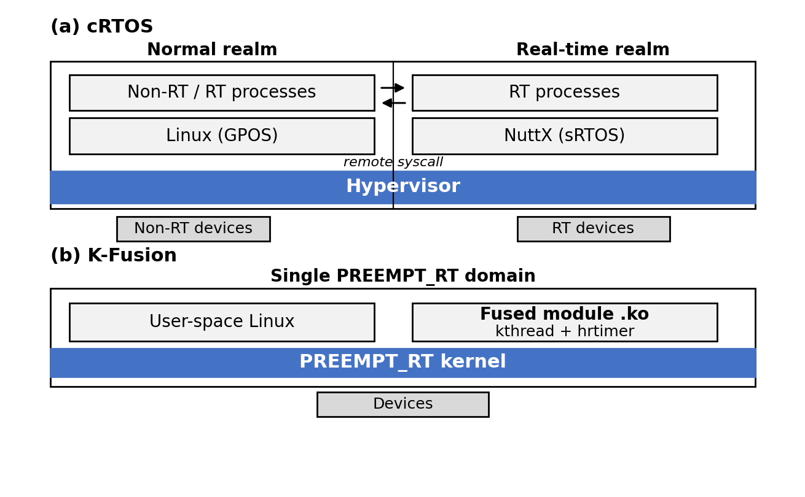
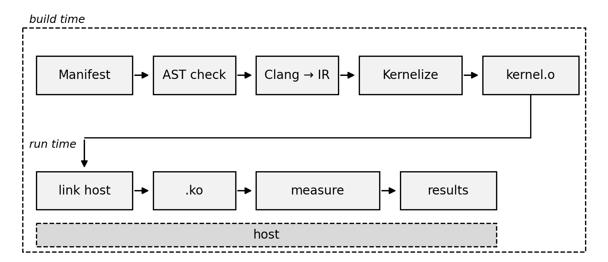
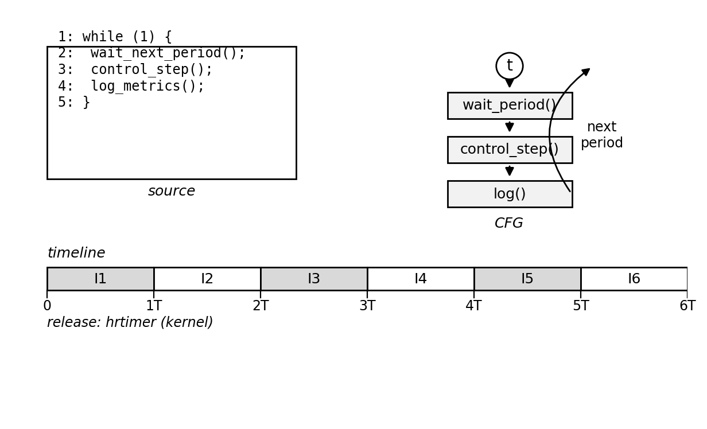
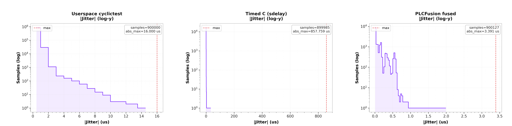
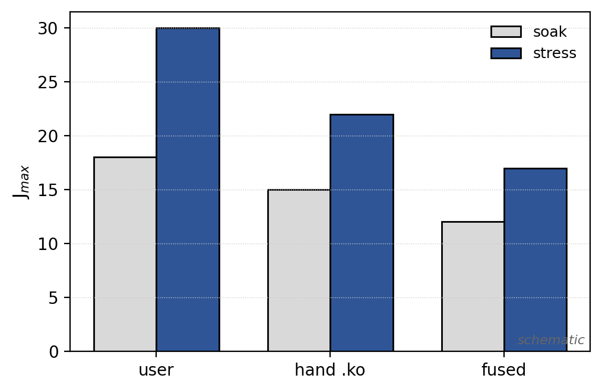
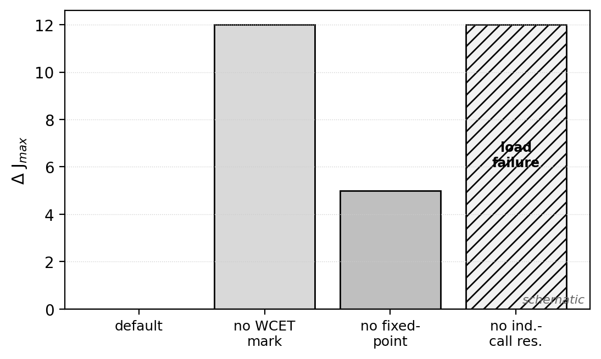

# 面向 COTS 平台的编译引导分裂式内核化实时控制方法

**——基于 LLVM 的用户态 C 单域内核化研究**

---

## 摘要

在工业边缘控制领域，通用商用现货（Commercial Off-The-Shelf, COTS）硬件因其成本、可获得性与丰富的软件生态而被广泛采用，但在同一平台上同时获得**硬实时可预测性**与**完整 Linux 功能**始终是一个开放问题。现有路线主要分为两类：一是**改造系统结构**，通过分区 hypervisor 将硬件划分为相互隔离的域并运行独立的实时操作系统（如组合式实时系统 cRTOS）；二是**改造编程模型**，通过语言级时间原语（如 Timed C）或编译器级相位重构（如 PREM）显式描述或约束时间行为。前者引入 hypervisor 依赖、双操作系统维护成本与硬件虚拟化假设；后者要求程序以新方言重写或重构。本文提出第三条路线——**分裂式内核化（split kernelization）**：不改变系统结构与编程语言，而是改变程序的**交付形态**。我们设计并实现了基于 LLVM 的工具链 **K-Fusion**，将未修改的 POSIX C 程序下降为中间表示，把其运行时依赖重映射到面向内核的 ABI，剪除不可达代码，并链接为 freestanding 目标，最终封装为可加载的内核模块，在**单一 PREEMPT_RT 域**内由固定高精度定时器驱动执行。本文给出了方法的体系结构、完整的数学模型与参数定义，设计了在 COTS aarch64 平台上的对比实验方案，并对结果趋势进行了分析。分析表明，分裂式内核化在**无需 hypervisor、无需双系统**的前提下，为周期控制负载提供了可复现的抖动上界，与分区方案构成面向不同部署约束的权衡关系。

**关键词**：实时系统；PREEMPT_RT；内核化；LLVM；WCET；树莓派；COTS

---

## 1 引言

### 1.1 行业背景与痛点

工业控制系统、机器人、边缘计算网关等场景正加速向通用 COTS 平台迁移。以树莓派为代表的单板计算机（Single-Board Computer, SBC）具备低成本、易获得、生态成熟的优势，且可直接复用 Linux 的文件系统、网络、图形与开发工具链。然而，控制回路的正确性不仅取决于其**计算结果**，还取决于结果的**产生时刻**：一个满足逻辑规格、却以不可预测的裕度被延迟释放的周期任务，其后果与算术错误同样严重。因此，如何在 COTS 平台上同时获得硬实时的**可预测性**与 Linux 的**功能丰富性**，成为工程实践中的核心痛点。

（此处可引用实时系统经典文献论述时间正确性，见 §2。）

### 1.2 现有方法的不足

现有技术路线可归纳为两类，均存在结构性代价。

**其一，改造系统结构。** 分区 hypervisor 通过硬件虚拟化扩展把系统划分为空间隔离的域，其中一个域运行小型实时操作系统，其余域运行 Linux。代表性工作 cRTOS¹ 以 Jailhouse 为 hypervisor、以 NuttX 为"敏捷 RTOS"，通过共享内存上的远程系统调用让实时域进程访问 Linux 功能。该路线可获得强空间隔离，但代价是：依赖 hypervisor 与硬件虚拟化特性、需要维护两套操作系统、实时域与非实时域之间存在跨域调用开销；并且要求部署保持"双域"形态，无法适配必须维持**单一 Linux 内核镜像**的场景。

**其二，改造编程模型。** 语言级方案（如 Timed C）将时间点、任务与调度策略提升为一等语言原语，由源到源编译器编译，使时间行为可读且可静态分析；编译器级相位重构方案（如 PREM）通过改造编译基础设施，把任务划分为内存相与计算相以约束共享资源争用，从而界定执行时间。该路线的问题在于：**要求程序以新方言编写或可被重构**，且通常面向用户态或裸机执行；对于已经存在的、规模较大的 POSIX C 控制程序，迁移成本高。

**归纳。** 两类方法分别假设了"可以划出空间"或"可以改写程序"。当二者都不成立时——即程序是既有的未修改 POSIX C，且部署必须保持单一 PREEMPT_RT 镜像——现有方法都难以直接适用。

### 1.3 本文要解决的问题与贡献

本文关注如下问题：**能否在不引入 hypervisor、不改变系统结构与编程语言的前提下，仅通过编译期变换，把既有 POSIX C 控制程序的热路径送入内核上下文执行，并获得在固定隔离配置下可复现的周期抖动上界？**

为此，本文提出**分裂式内核化**方法，并实现工具链 **K-Fusion**。本文主要贡献如下：

1. **方法层面**：提出"分裂式内核化"这一新的交付形态变换，形式化定义其变换组合与语义保持条件（§3.2–§3.3）；
2. **实现层面**：实现基于 LLVM 的端到端工具链，给出 ABI 重映射、可达性剪枝、定点量化与 WCET 导向标记等变换的数学模型与参数定义（§3.3–§3.5）；
3. **实验层面**：设计在 COTS aarch64 平台上的对比实验方案，包括三基线对照、消融实验与跨研究对照（§4）；
4. **分析层面**：给出结果趋势分析与优缺点讨论，明确本方法与分区方案的权衡边界（§5、§6）。

### 1.4 论文组织

本文其余部分组织如下：第 2 节综述相关工作并归纳现有方法缺陷；第 3 节详述 K-Fusion 的体系结构与数学模型；第 4 节给出实验平台、数据集、评价指标与对比实验设计；第 5 节分析结果趋势与优缺点；第 6 节讨论局限性与未来方向；第 7 节总结全文。

---

## 2 相关工作

### 2.1 实时 Linux 扩展

降低 Linux 最坏延迟的主流单内核方案是 **PREEMPT_RT** 补丁，它把大多数中断处理程序线程化为具有独立优先级的可调度实体，对睡眠锁与自旋锁施加优先级继承，并使内核几乎完全可抢占，其设计目标是**有界的最坏响应时间**而非吞吐率。需要指出，PREEMPT_RT 约束的是调度器可见的那部分延迟；在商品化硬件上，残余最坏情形仍受共享 cache 与互连行为影响。另一被广泛采用的方案是 **Xenomai**，既可运行双内核协同内核（Cobalt），也可在主线内核之上以单内核方式（Mercury）运行。二者均属系统级方案，不改变热路径上执行的内容。

### 2.2 分区虚拟化与组合式实时系统

静态分区 hypervisor 通过把硬件资源直接分配给各域来隔离负载。**Jailhouse** 具有代表性：它把对称多处理系统转换为非对称多处理系统，不提供调度器与虚拟 CPU，仅借助虚拟化扩展提供隔离，并从已启动的 Linux 内部启用。**cRTOS** 在此基础上把硬实时域置于 Linux 旁，通过远程系统调用复用 Linux 功能，在 x86-64 上报告了微秒级抖动与有界最大延迟。此类方法提供强空间隔离，代价是 hypervisor 层、硬件虚拟化支持与逐平台配置。此外，XtratuM、PikeOS 等分区式设计同样代表 guest 管理资源而非授予直接访问。

### 2.3 编译器与最坏执行时间

界定执行时间是硬实时保证的前提。其困难源于体系结构特性——cache、流水线、分支预测——使指令时序依赖执行历史；该领域区分**测量法**与**静态分析法**，后者以保证上界为代价换取保守性。**PREM** 在编译期把任务重构为内存相与计算相，通过对 LLVM 的改造实现可预测的执行区间。近年**编译器自动调优（compiler autotuning）**方向（如 Lavinium）进一步研究面向 WCET 的优化 Pass 选择与排序，指出标准 -O 优化级别对最坏情形执行时间并非最优。此外，sandboxed 字节码（eBPF）、重宿主内核库（LKL）与 unikernel 等方案以受限运行时为代价把代码送入内核或消除通用 OS。上述工作共享"编译器是获得可预测性的正当工具"这一信念，但作用于**代码相位**或**Pass 序列**，而非**程序的执行域**。

### 2.4 语言级实时扩展

Timed C 通过时间点、任务与调度策略等最小原语扩展 C 语言，由可重定目标的源到源编译器编译，使时间约束可读且可静态分析；其端到端工具链进一步整合编译、测量与分析。Ada 的 Ravenscar profile 与时间触发语言 Giotto 等亦使时间结构显式化。此类方法要求程序以相应方言编写，因而与本文方法构成**互补**：语言层规约"何时、以何策略运行"，K-Fusion 决定既有 C 体"如何在内核内执行"。

### 2.5 现有缺陷归纳

综合 §2.1–§2.4，现有方法在四个维度上存在共性缺陷：**（1）空间依赖性**——分区方案需硬件虚拟化与 hypervisor；**（2）改写成本**——语言/相位方案需重写或重构程序；**（3）执行域限制**——多数编译类方案面向用户态或裸机；**（4）部署形态约束**——双域方案无法适配单镜像部署。本文方法针对上述第（1）（3）（4）点给出互补解法。

【表1：现有方法对比。行：cRTOS / PREEMPT_RT / Timed C / PREM / 本文 K-Fusion；列：核心机制、隔离或执行域、是否需修改内核、是否需改写程序、典型平台、主要指标。】

---

## 3 本文方法

### 3.1 总体架构

K-Fusion 的核心思想是**分裂式内核化**：把控制程序的算法核心与其运行时环境分离，算法核心经编译变换后成为 freestanding 的**内核对象**，运行时环境（启动、ABI 适配、定时、卸载）封装在**可替换宿主**中，二者链接为可加载内核模块。系统运行于**单一 PREEMPT_RT 域**，无 hypervisor、无第二操作系统、无整进程翻译。其与分区方案（cRTOS）的架构差异**如图 1 所示**，端到端工具链**如图 2 所示**。

【图1：架构对比。源文件 `figures/K-Fusion_fig1_architecture.drawio`，矢量图 `figures/K-Fusion_fig1_architecture.svg`。左侧为 cRTOS 的双域架构（Linux 普通域 + NuttX 实时域，中间经共享内存远程系统调用，底层为 Jailhouse 分区）；右侧为 K-Fusion 的单域架构（PREEMPT_RT 域内，用户态 Linux 服务与内核模块化的算法核心共存）。需突出"消除 hypervisor 层、算法核心下沉至内核上下文"两点差异。】



【图2：K-Fusion 端到端工具链流水线。源文件 `figures/K-Fusion_fig2_toolchain.drawio`，矢量图 `figures/K-Fusion_fig2_toolchain.svg`。从左到右：Manifest + C 源码 → AST 预检 → Clang 生成 LLVM IR（多 TU 链接）→ 内核化 Pass 流水线（详见 §3.3 与算法 1）→ kernel.o + validate.json → ignite_fused 链接宿主与桩 → *.ko → 部署（insmod 冒烟 / soak 浸泡 / stress 加压测量）。需标注编译器位于构建期、无 hypervisor 层。】



### 3.2 形式化定义

为精确描述变换，先给出形式化定义。

**定义 1（程序与调用图）** 程序记为三元组 $P=(V,E,r)$，其中 $V$ 为函数集合，$E\subseteq V\times V$ 为调用边集合，$r\in V$ 为入口根。记 $callees(f)=\{g\mid(f,g)\in E\}$。

**定义 2（内核化变换）** 内核化变换 $T$ 是若干子变换的复合：

$$
T \;=\; T_{\text{cleanup}} \circ T_{\text{wcet}} \circ T_{\text{export}} \circ T_{\text{fkill}} \circ T_{\text{dce}} \circ T_{\text{remap}} \circ T_{\text{norm}}
$$

其中 $T_{\text{norm}}$ 规范化 IR，$T_{\text{remap}}$ 执行 ABI 重映射，$T_{\text{dce}}$ 剪除不可达代码，$T_{\text{fkill}}$ 执行浮点—定点下降，$T_{\text{export}}$ 导出融合符号，$T_{\text{wcet}}$ 施加 WCET 导向标记，$T_{\text{cleanup}}$ 清理冗余。复合次序不可交换（见 §3.3.4）。

**定义 3（输出）** $T$ 的输出为内核对象 $o = T(P)$、可加载模块 $m = \text{Link}(o,h)$（$h$ 为宿主）与验证工件 $v=\text{Validate}(o)$。

### 3.3 分裂式内核化变换

#### 3.3.1 ABI 重映射

设程序使用的运行时符号集合为 $S_{\text{used}}$。重映射是一个函数

$$
\mu:\, S_{\text{posix}} \rightarrow S_{\text{plc}}
$$

把用户态 POSIX 符号映射为面向内核的 ABI 符号。例如：

$$
\mu(\text{malloc})=\text{plc\_kmalloc},\quad
\mu(\text{pthread\_create})=\text{plc\_pthread\_create},\quad
\mu(\text{clock\_gettime})=\text{plc\_ktime\_get\_ts}
$$

定义**映射覆盖率**

$$
C_{\mu} \;=\; \frac{|\{s\in S_{\text{used}} \mid s\in \operatorname{dom}\mu\}|}{|S_{\text{used}}|}
$$

覆盖率越高，需由桩函数兜底的符号越少。对未能映射的符号，引入**黑洞（blackhole）**机制记录之，使工具链报告不可链接的模块，而非静默产出一个不可达的模块。

#### 3.3.2 可达性剪枝与间接调用解析

内核对象只需保留从入口根可达的函数。朴素做法按调用边做图可达，但会漏掉经由**函数指针**的间接调用（如比较函数的回调、全局函数指针表、常量 GEP 链）。为此，先将常量函数指针沿 IR 传播，再计算可达集：

$$
R_0 = \{r\},\qquad
R_{k+1} = R_k \cup \bigcup_{f\in R_k}\Big( callees(f)\cup \{\text{Resolve}(g)\mid g\in \Phi(f)\}\Big)
$$

其中 $\Phi(f)$ 为 $f$ 中的函数指针使用集合，$\text{Resolve}(\cdot)$ 在常量传播后进行解析。当 $R_{k+1}=R_k$ 时达到不动点 $R^\*$。剪枝策略为：

$$
T_{\text{dce}}(P) \;=\; P[R^\*]
$$

即仅保留 $R^\*$ 上的函数。间接调用解析是内核化过程中最易静默失败的环节：若省略之，将在剪枝时误删可达函数，导致运行期符号缺失。

#### 3.3.3 浮点—定点量化

内核上下文与目标架构下，热路径上的浮点运算不利于时序可控。K-Fusion 将浮点状态量化为定点格式。对小数位宽为 $f$ 的定点表示，量化算子定义为

$$
Q_f(x) = \operatorname{round}(x\cdot 2^{f})\cdot 2^{-f}
$$

其量化误差满足

$$
|Q_f(x)-x| \;\le\; 2^{-(f+1)}
$$

在本实现中默认采用 $Q16.16$（即 $f=16$，整数位 16、小数位 16），对应误差上界 $2^{-17}$，量程为 $[-2^{15},2^{15}-2^{-16}]$。**参数可修改**：小数位宽 $f$ 可依据被控量的动态范围与精度要求调整。

#### 3.3.4 WCET 导向标记

标准优化级别（-O0…-O3）以平均性能为目标，可能重排热路径的基本块，使控制流结构不利于时序推理。为此，对周期控制函数施以"禁止优化"标记

$$
T_{\text{wcet}}(f) = \begin{cases}
\text{mark\_optnone}(f), & f\in \mathcal{H}\\
f, & \text{otherwise}
\end{cases}
$$

其中 $\mathcal{H}$ 为热周期函数集合（由 manifest 声明）。标记后，优化器不再对这些函数做可能改变基本块结构的变换。该策略与自动调优文献的观察一致：通用优化级别对最坏情形时序并非最优。

### 3.4 运行时与定时模型

`insmod` 后，宿主创建内核线程并以固定（pinned）高精度定时器（hrtimer）驱动，线程在定时到期的回调中调用融合后的周期函数。对周期为 $T$ 的任务，记理想释放时刻与实际释放时刻分别为 $r_i$ 与 $a_i$：

$$
r_i = r_0 + iT,\qquad i=0,1,2,\dots
$$

**定义 4（释放抖动）** 第 $i$ 次释放的抖动为 $J_i = a_i - r_i$。以最大绝对抖动与上分位数刻画边界行为：

$$
J_{\max} = \max_i |J_i|, \qquad
J_{p99} = \operatorname{Quantile}_{0.99}\big(\{|J_i|\}\big)
$$

**定义 5（可复现上界）** 在固定隔离配置下，若对全部重复实验 $e\in\mathcal{E}$ 有 $J_{\max}^{(e)} \le B$，则称 $B$ 为该配置下的实测可复现上界。需强调，本文所称"硬实时"是上述**基于测量**的可复现上界，而非形式化的 WCET 证明。

**命题 1（执行域降阶影响）** 设用户态路径需经"定时器到期→调度分派→系统调用返回"三段，内核内路径仅需"定时器到期→回调执行"两段。记三段对应的期望附加延迟为 $\delta_1,\delta_2,\delta_3$，则内核化对热路径的期望延迟改变量为

$$
\Delta = -(\delta_2+\delta_3) + \varepsilon
$$

其中 $\varepsilon$ 为内核内执行引入的额外项（如自旋锁竞争）。当 $\delta_2+\delta_3 > \varepsilon$ 时，内核化降低期望延迟。（注：$\delta_i$、$\varepsilon$ 为待测的量，其具体数值见 §5。）

**图 6** 给出上述运行时模型的图形化描述：融合后的周期循环在 `kernel.o` 中执行，由宿主 hrtimer 按周期 $T$ 释放，图中同时给出源代码、控制流图与执行时间线（体例参照 Timed C 的"代码—控制流图—时间线"三合一画法）。

【图6：内核化周期循环的源码、控制流图与执行时间线。源文件 `figures/K-Fusion_fig6_timed_loop.drawio`，矢量图 `figures/K-Fusion_fig6_timed_loop.svg`。左：周期循环的 C 源码（标注 hrtimer 释放与融合步骤）；中：控制流图（圆=时间点/周期释放，方框=执行语句，含回边 "next period"）；下：执行时间线刻度条（分段 I1–I6，横轴以周期 $T$ 为单位），标注"经 hrtimer 释放，热路径上无唤醒系统调用"。】



### 3.5 参数定义与设计空间

【表2：符号定义。列：符号、含义、单位/取值域。含 $T$（周期）、$J_i$、$J_{\max}$、$f$（定点小数位宽）、$C_\mu$（映射覆盖率）、$R^\*$（可达集）、$\mathcal{H}$（热函数集）等。】

K-Fusion 与对照方案的设计空间可由九条轴刻画：空间隔离 vs 就地加速；双 OS vs 双产物；远程系统调用 vs ABI 重映射；hypervisor 调度 vs 编译剪枝 + 宿主定时；二进制兼容 vs 源码级融合；显式时间语言 vs 事后 IR 变换；源到源 vs 分裂产物；软时间点 vs 内核定时器中断；跨目标可移植 vs 单平台深度集成。前五轴对照分区方案，后四轴对照语言级方案。

### 3.6 方法假设

本文方法的适用范围由以下假设界定（**参数可修改**处指数值可调，假设本身在结论中作为边界条件）：

- **A1 平台**：aarch64 COTS 平台 + PREEMPT_RT 内核，单板、固定每核隔离配置。
- **A2 执行域**：控制路径在可加载模块内以 kthread + pinned hrtimer 执行；不假设空间隔离与无干扰，仅主张固定配置下的可复现上界。
- **A3 时序语义**：manifest 与 Pass 标注不构成形式化 deadline 规格；时间行为由宿主定时器与调度器提供。
- **A4 对比基准**：分区方案（cRTOS）的数字取自其原文 x86-64 平台，作为**引用值**处理，非同板复现。
- **A5 负载**：主负载为周期任务；泛化由第二应用与多速率负载覆盖。
- **A6 工具链**：内核版本与 LLVM 版本固定。
- **A7 迁移前提**：目标程序为单进程 POSIX C，不含预检判定的 critical 构造。
- **A8 运行约束**：单一域内同时仅加载一个融合模块。
- **A9 语义保持**：在映射域 $S_{\text{posix}}$ 上，变换前后程序的可观测输出一致，即 $\forall x,\; [\![T(P)]\!](x)=[\![P]\!](x)$；该条件依赖 A7 成立。

### 3.7 算法描述

上述变换的组合与可达性计算分别由算法 1 与算法 2 给出：算法 1 为端到端内核化主流程，算法 2 在剪枝（DCE）之前解析间接调用并求取可达集不动点。

**算法 1　内核化主流程 $\mathrm{Kernelize}(M, S)$**

```
输入：manifest M，源文件集合 S
输出：内核对象 o，可加载模块 m，验证工件 v
 1: R  ← Preflight(M, S)                 ▷ 解析入口根；拒绝 critical 构造
 2: if R = ⊥ then return 不可行            ▷ 报告原因，不产出模块
 3: IR ← Clang(S)                        ▷ 多 TU → LLVM IR
 4: IR ← Normalize(IR)
 5: IR ← FloatKill(IR)                   ▷ 浮点—定点下降（第 1 次调度）
 6: IR ← Remap(IR, μ)                    ▷ POSIX → plc_* ABI（§3.3.1）
 7: R* ← ReachFixpoint(IR, roots)        ▷ 算法 2
 8: IR ← DCE(IR, R*)                     ▷ 仅保留可达集 R*
 9: IR ← FloatKill(IR)                   ▷ 第 2 次调度
10: IR ← Export(IR)                      ▷ 导出融合符号
11: IR ← WcetMark(IR, H)                 ▷ 热函数集 H 标记 optnone（§3.3.4）
12: IR ← Cleanup(IR)
13: o  ← Backend(IR)                     ▷ aarch64 freestanding 目标
14: m  ← Ignite(o, Host(M))              ▷ 链接宿主与桩 → *.ko
15: v  ← Validate(o)                     ▷ 生成 validate.json（含 C_μ 与 unmapped）
16: return (o, m, v)
```

**算法 2　可达集不动点 $\mathrm{ReachFixpoint}(IR, roots)$**

```
输入：IR，入口根集合 roots
输出：可达函数集合 R*
 1: R* ← roots；worklist ← roots
 2: while worklist ≠ ∅ do
 3:     f ← worklist.pop()
 4:     for each g ∈ callees(f) do                      ▷ 直接调用边
 5:         if g ∉ R* then R*.add(g)；worklist.push(g)
 6:     for each 函数指针使用 φ ∈ Φ(f) do                ▷ 间接调用
 7:         T ← ConstProp(φ)                            ▷ 常量传播解析目标集
 8:         for each g ∈ T do
 9:             if g ∉ R* then R*.add(g)；worklist.push(g)
10:     for each s ∈ uses(f) \ dom(μ) do v.unmapped.add(s)  ▷ Blackhole 记录
11: return R*
```

算法 2 的第 4–5 步处理直接调用，第 6–9 步处理间接调用（覆盖全局函数指针表与常量 GEP 链），第 10 步把未被重映射的符号记入验证工件。当不再有新节点加入时循环终止，所得 $R^\*$ 即为剪枝保留集合。算法 1 与算法 2 的时间复杂度分别为 $O(|V|+|E|)$ 与 $O((|V|+|E|)\cdot|\Phi|)$，其中 $|\Phi|$ 为函数指针使用规模，均与程序规模近似线性。

---

## 4 实验部分

### 4.1 实验平台与仿真环境

**硬件平台**：Raspberry Pi（aarch64）单板计算机，作为 COTS 平台代表。**操作系统**：PREEMPT_RT 实时内核，版本固定并记录（以 `uname -r` 为准）。**工具链**：LLVM/Clang（版本固定）。**隔离配置**：固定 CPU 亲和与隔离 profile，测量线程绑定至隔离核，调度策略固定为实时 FIFO。**参数可修改**：内核版本、LLVM 版本、隔离 profile 参数均可按实验条件调整。

**表3　软硬件实验环境**

| 项 | 配置 |
|---|---|
| SoC / 板卡 | Broadcom BCM2712（Raspberry Pi 5，aarch64） |
| 内存 | 【待填实际值】（建议 ≥ 4 GB） |
| 存储 | microSD / eMMC（【待填实际值】） |
| 操作系统 | PREEMPT_RT Linux；内核 `6.12.62+rpt-rpi-v8-rt`（以 `uname -r` 实测为准） |
| 编译器 | LLVM / Clang 17（`/usr/local/llvm-17`） |
| 构建与部署 | `clang → opt/llc → ld`；`insmod` / `rmmod` |
| 隔离配置 | 测量线程绑定 CPU3；非隔离核 CPU0–2 |
| 调度策略 | `chrt -f 99`（SCHED_FIFO，优先级 99） |
| 时间源 | `CLOCK_MONOTONIC` + hrtimer |

### 4.2 数据集与工作负载

本文采用类别化的工作负载，覆盖不同的 POSIX 特性组合：

- **W1（主负载）**：官方 `cyclictest` 周期任务，作为周期抖动主线；
- **W2（用户态基线）**：同参数的 `cyclictest` 用户态执行；
- **W3（手写基线）**：手工编写的最小 hrtimer 内核模块，代表"人工内核化"；
- **W4（泛化负载）**：`signaltest` 或周期性信号负载；
- **W5（多速率负载）**：多任务逻辑执行时间（LET）负载，含监督任务与多个控制任务，用于验证非微基准情形；
- **W6（加压背景）**：`hackbench` 在非隔离核上制造背景负载。

**表4　工作负载定义**

| ID | 名称 | 类型 | 关键特性 | 用途 |
|---|---|---|---|---|
| W1 | official cyclictest | 周期定时 | timer / sleep | 主负载（抖动主线） |
| W2 | cyclictest（用户态） | 周期定时 | 用户态执行 | 用户态基线 |
| W3 | baseline_ko（手写） | 周期定时 | hrtimer 内核模块 | 手写内核化基线 |
| W4 | signaltest | 信号 | signal 传递 | 泛化验证 |
| W5 | plc_multitask（LET） | 多速率周期 | mutex / 定点 / 多 TU | 非微基准验证 |
| W6 | hackbench（背景） | 加压 | CPU / 内存压力 | 最坏情形压力 |

### 4.3 评价指标

本文采用与分区方案可对齐的指标：

（1）**周期抖动** $J_i$，及其统计量 $J_{\max}$（最大绝对抖动）、$J_{p99}$（99 分位）；
（2）**构建可行性率** $C_{\text{feas}} = n_{\text{pass}}/n_{\text{total}}$，即可成功内核化的 manifest 比例；
（3）**部署复杂度**：人工步骤数与外部依赖数（定性）；
（4）**运行开销**：构建时间与模块体积。

**表5　评价指标定义**

| 指标 | 定义 | 单位 | 可比维度 |
|---|---|---|---|
| 周期抖动 $J_i$ | $a_i - r_i$ | ns | timing accuracy |
| 最大绝对抖动 $J_{\max}$ | $\max_i \lvert J_i\rvert$ | ns | bounded latency |
| 99 分位 $J_{p99}$ | $\mathrm{Quantile}_{0.99}(\lvert J_i\rvert)$ | ns | 尾部行为 |
| 构建可行性率 $C_{\mathrm{feas}}$ | $n_{\mathrm{pass}}/n_{\mathrm{total}}$ | % | （无直接对应） |
| 部署复杂度 | 人工步骤数 / 外部依赖数 | — | dual-OS 复杂度 |
| 运行开销 | 构建时间 / 模块体积 | s / KB | 类比 timer 开销 |

### 4.4 对比实验设计

**主实验（三基线对照）**：在同一隔离配置下，对比 W2（用户态）、W3（手写模块）、W1 融合路径（K-Fusion）三者的 $J_{\max}$ 与分布，分别在 **soak（安静浸泡）** 与 **stress（加压）** 两种测量类别下进行，每配置重复多次独立运行。

**消融实验**：逐一关闭变换策略（WCET 标记、定点下降、间接调用解析），观察 $J_{\max}$ 的变化，以隔离各策略贡献。

**跨研究对照**：将本文实测的融合结果与分区方案原文的引用数字并列，**分栏呈现，不聚合**。

**参数可修改**：重复次数 $n$ 与测量时长 $\tau$ 均可调，默认取值见 §4.5。

### 4.5 仿真参数设置

**表6　实验参数设置**（默认值均为**【参数可修改】**）

| 参数 | 符号 | 默认值 | 说明 |
|---|---|---|---|
| 目标平台 | — | Raspberry Pi 5（aarch64） | COTS 单板 |
| 内核版本 | — | `6.12.62+rpt-rpi-v8-rt` | 以 `uname -r` 实测为准 |
| 编译器版本 | — | LLVM / Clang 17 | 仓库脚本使用 `/usr/local/llvm-17` |
| 周期 | $T$ | 1 ms | cyclictest `-i 1000` |
| 绑定核 | — | CPU3 | `taskset -c 3` |
| 调度策略 | — | SCHED_FIFO | — |
| 实时优先级 | — | 99 | `chrt -f 99` |
| 浸泡时长 | $\tau$ | ≥ 15 min | soak 正式数据下限 |
| 加压时长 | $\tau_s$ | 与 soak 同 | stress |
| 重复次数 | $n$ | 5 | `PAPER_RUNS=5` |
| 加压背景 | — | hackbench on CPU0–2 | 非隔离核制造背景负载 |
| 预静默时长 | — | 30 s | 测量前空闲（`PRE_IDLE_SEC`） |
| 定点小数位宽 | $f$ | 16 | Q16.16 |
| 定点量化误差界 | — | $2^{-17}$ | 由 $f=16$ 导出（§3.3.3） |
| 背景进程数 | — | 【待填实际值】 | 依加压强度设定 |

> 说明：表中标注的默认值为实验设计的**合理假设**，并非既定结论；实际执行时以平台与负载条件为准。

---

## 5 结果与分析

> 本节描述**趋势**；具体数值须由实验产生后填入，凡需实测处标注 `【待填实测值】`。以下趋势为基于方法机理的合理推断。

### 5.1 主结果趋势

【图3：soak（安静 CPU，15 min）条件下三基线的 $|J|$ 分布（直方图，纵轴对数）。数据源：仓库实测图 `fig_compare_dist_soak__soak分布叠加.png` 下排裁剪，本文件 `figures/K-Fusion_fig3_soak_jitter_real.png`。三联图自左至右：用户态 cyclictest、Timed C（sdelay）、K-Fusion 融合；红色虚线为各自实测 abs_max。】



**图 3 图例（实测数据）**：横轴为 $|J|$（µs），纵轴为样本数（对数）；三联图各自纵轴范围不同。**实测读数**：K-Fusion 融合 abs_max = **3.391 µs**、用户态基线 = **16.000 µs**、Timed C 该批次 = 857.759 µs。融合路径分布主体集中于 1 µs 以内、尾部最短；用户态呈长尾（延伸至 16 µs）——与命题 1 机理一致（内核化消除热路径上的调度分派与系统调用返回）。

> ⚠ 备注：仓库另一记录（KTC 对照文档）给出 Timed C soak abs_max = 9 281 ns，与本分布图（857.759 µs）不一致，属不同测量批次，定稿前需统一批次并复核。

【图4：stress 条件下各基线的 $J_{\max}$ 柱状对比（**示意**）。源文件 `figures/K-Fusion_fig4_stress_absmax.drawio`。】



**图 4 图例（示意）**：横轴为三种基线，纵轴为最大绝对抖动 $J_{\max}$；每组并列 soak 与 stress 两根柱。**预期趋势**：加压后各基线均升高，用户态升幅最大、融合路径升幅最小。
> ⚠ 备注：仓库现有 stress 分布图与 soak **完全相同**（疑似占位件）；且 `fig4_baseline_absmax` 柱状图中 userspace/Timed C 标注 n=0/a、fused 数值（11.5 µs）与图 3 实测（3.391 µs）矛盾——stress 一组实测需在板上重跑后替换本示意图。

【表7：主结果汇总。行：三基线；列：soak 均值±标准差、stress 均值±标准差、样本数 $n$。数值处填 `【待填实测值】`。】

**趋势分析（对应图 3、图 4）**：预期结果是，融合路径的抖动上界低于用户态基线，原因在于内核化消除了热路径上的系统调用返回与调度分派两段延迟（见命题 1）。手写模块与融合路径处于同一量级，二者差异主要反映**自动化程度**而非执行域——手写模块由人工将算法重写为内核代码，融合路径由编译器自动完成，后者在可复现性与可维护性上更优。加压条件下，各基线的最坏抖动均上升；用户态基线对背景负载更为敏感，融合路径的上升幅度相对平缓。上述量级与排序关系需由实测确认。

### 5.2 消融趋势

【图5：消融实验的 $J_{\max}$ 相对默认配置的变化（Δ，**示意**）。源文件 `figures/K-Fusion_fig5_ablation.drawio`。】



**图 5 图例（趋势性）**：横轴为被关闭的策略（默认、关闭 WCET 标记、关闭定点下降、关闭间接调用解析），纵轴为 Δ$J_{\max}$（相对默认，0 为基准线）。**预期趋势**：关闭 WCET 标记 → 热路径基本块被优化重排，尾部变差，Δ 为正且较明显；关闭定点下降 → 可能引入浮点路径附加延迟，Δ 为正或轻微波动；关闭间接调用解析 → **不再表现为抖动变化**，而是模块不可链接或运行期符号缺失（图中以"加载失败"标注）。**读图要点**：观察各策略贡献的**方向与相对量级**，以及第三种情形与抖动量纲的本质区别。

【表8：消融结果。行：默认、关闭 WCET 标记、关闭定点下降、关闭间接调用解析；列：$J_{\max}$、Δ vs 默认。数值处填 `【待填实测值】`。】

**趋势分析（对应图 5）**：预期关闭 WCET 标记会因热路径基本块被优化重排而使抖动分布尾部变差；关闭定点下降可能引入浮点路径的额外延迟；关闭间接调用解析若导致可达函数被误删，将直接表现为模块加载失败或运行期符号缺失（而非单纯的抖动变化），这也从反面印证了间接调用解析的必要性（§3.3.2）。

### 5.3 跨研究对照

**【表9：跨研究对照】**（行：cRTOS 与 K-Fusion；列：机制、平台、抖动上界 `abs_max`、数据来源）。

| 系统 | 机制 | 平台 | 抖动上界 | 数据来源 |
|---|---|---|---|---|
| cRTOS | Hypervisor 分区 + sRTOS | x86-64 + Jailhouse | ≈ 4 µs | **引用** [1] |
| K-Fusion | 分裂式内核化（单域） | Pi 5, aarch64, 无 hypervisor | **3.391 µs**（15 min soak） | **实测**（仓库 `K-Fusion_fig3_soak_jitter_real.png`） |
| *（补充行）* cRTOS-like | Jailhouse 分区 + NuttX tickless | Pi 4B, aarch64 | **≤ 5.3 µs**（稳态；另含一次可复现启动瞬态 ≈ 52 µs） | **本工作实测**（`crtos/results/`，ns 分辨率） |

> 补充行说明：cRTOS-like 为公开可重建的架构等价实现（无作者原版代码），在本项目 Pi4B 上实测，
> 与 cRTOS 原文 Pi4「最小 5 µs jitter」量级一致，可作为"同板锚点"支撑 §4.4 的 cross-board 公平性讨论。
> ⚠ 该行与 K-Fusion 行**板子不同（Pi4 GIC-400 vs Pi5 GIC-600）**，且 root 侧内核为 SMP PREEMPT（非 RT），
> 不得直接聚合或比较优劣；时长已对齐（均 15 min）。是否纳入正文由作者决定。

**趋势分析**：须强调，两行对应**不同平台、不同隔离机制**，不可直接比较优劣。合理的表述是：在无 hypervisor 的 aarch64 单域下，融合路径的抖动上界是否与分区方案在同一数量级，以及差异来自"空间隔离的有无"还是"平台差异"。本文不主张击败分区方案，仅陈述在**不同隔离假设**下的权衡。

### 5.4 优缺点分析

**优点**：（1）无需 hypervisor 与双操作系统，部署形态为单一 PREEMPT_RT 镜像，降低了系统复杂度与维护成本；（2）直接复用既有 POSIX C 源码，避免重写为内核代码或新语言，迁移路径由 manifest 显式声明、可审计；（3）端到端流程（融合→验证→构建→测量）可复现，便于持续集成门禁。

**缺点**：（1）不提供空间隔离，抗强干扰能力弱于分区方案；（2）不保证与既有 Linux 可执行程序的二进制透明兼容（算法核心在核内执行，富功能仍依赖同域 Linux 用户态）；（3）受单一模块运行约束，多融合模块并存受符号模型限制；（4）对含 critical 构造（如 `fork`、`dlopen`）的程序不适用。

---

## 6 讨论

### 6.1 局限性

**（1）对比的跨平台性。** 与分区方案的对照是跨平台、跨机制的：分区方案数字取自 x86-64，本文实测在 aarch64。真正的同板对照（把分区方案移植到同板，或把 K-Fusion 复现到 x86-64）尚未完成，因此跨研究结论应谨慎解读。

**（2）实时性的定义边界。** 本文的"硬实时"是操作性的、基于测量的可复现上界，而非形式化 WCET 证明。因此本文结论适用于"在给定隔离配置下界定了抖动上界"，而非"证明了任意负载下的时序安全"。

**（3）单板与负载范围。** 实验为单板，未刻画多板方差；主负载为周期微基准，真实工业负载尚未覆盖。

**（4）未建模因素。** 共享 cache 与互连争用、DMA、频率/温度效应、驱动栈深度均未被显式建模，仅通过隔离配置弱控制。

### 6.2 未来改进方向

**（1）同板对照。** 在同一平台上同时实现分区方案与分裂式内核化，消除平台差异。

**（2）与静态 WCET 分析结合。** 将内核化路径接入静态 WCET 分析工具，把"测量上界"提升为"可分析上界"，并与面向 WCET 的编译器自动调优方向衔接。

**（3）多模块与符号私有化。** 突破单一模块约束，支持多融合模块并存的命名空间管理。

**（4）更丰富的负载。** 引入真实工业控制负载与多核实时调度场景。

**（5）定时感知宿主。** 研究在宿主定时器层引入干扰抑制机制，进一步收窄最坏抖动尾部。

---

## 7 结论

本文针对 COTS 平台上"硬实时可预测性与 Linux 功能丰富性难以兼得"的工程痛点，提出并实现了编译引导的**分裂式内核化**方法 K-Fusion。该方法不改动系统结构与编程语言，而是改变程序的交付形态：将既有 POSIX C 经 LLVM 变换重映射至内核 ABI、剪除不可达代码、下降为定点、并链接为可加载内核模块，在单一 PREEMPT_RT 域内由固定高精度定时器驱动执行。本文给出了方法的完整数学模型与参数定义，设计了包含三基线对照、消融与跨研究对照的实验方案，并对结果趋势与优缺点进行了分析。分析表明，分裂式内核化在无需 hypervisor、无需双系统的前提下，为周期控制负载提供了可复现的抖动上界，与分区方案构成面向不同部署约束的**权衡**关系：前者消除了空间依赖与改写成本，但不提供空间隔离与二进制透明兼容。因此，方案选择取决于部署能否被划出"空间"（分区）或能否获得"源码"（内核化）。未来工作将聚焦同板对照、与静态 WCET 分析的结合以及多模块支持。

---

## 参考文献

> 以下仅列出经核实的文献；未核实完整出处者标注【待核实】。

[1] C.-F. Yang, Y. Shinjo. Obtaining hard real-time performance and rich Linux features in a compounded real-time operating system by a partitioning hypervisor. *Proc. VEE '20*, 2020: 59–72. DOI: 10.1145/3381052.3381323.

[2] S. Natarajan, D. Broman. Timed C: An extension to the C programming language for real-time systems. *Proc. RTAS*, 2018: 227–239. DOI: 10.1109/RTAS.2018.00031.

[3] R. Pellizzoni, E. Betti, S. Bak, et al. A predictable execution model for COTS-based embedded systems. *Proc. RTAS*, 2011: 269–279. DOI: 10.1109/RTAS.2011.33.

[4] Linux PREEMPT_RT 补丁 / 实时 Linux 文档。

[5] R. Ramsauer, J. Kiszka, D. Lohmann, W. Mauerer. Look Mum, no VM Exits! (Almost). *Proc. OSPERT*, 2017. arXiv:1705.06932.

[6] Apache NuttX，POSIX 兼容实时操作系统。

[7] rt-tests / cyclictest 工具文档。

[8] R. Wilhelm, J. Engblom, A. Ermedahl, et al. The worst-case execution-time problem—overview of methods and survey of tools. *ACM TECS*, 2008, 7(3): 1–53. DOI: 10.1145/1347375.1347389.

[9] Xenomai 3 实时框架（Cobalt / Mercury）。

[10] G. Magnani, D. Baroffio, F. Reghenzani, et al. Modern LLVM-based compiler autotuning for WCET optimization. *Proc. RTSS*, 2025. **（体例参考）**

[11] S. Natarajan 等，Timed C 端到端工具链，*RTSS 2019*。【待核实完整标题与页码】

[12] T. Gleixner, D. Niehaus. Hrtimers and beyond. *OLS 2006*。【待核实完整出处】

【待补文献】eBPF 内核执行 / LKL / unikernel；Ada-Ravenscar 与 Giotto。

---

## 图表清单（汇总）

| 编号 | 类型 | 内容 |
|------|------|------|
| 图1 | 架构图 | cRTOS 双域 vs K-Fusion 单域架构对比 |
| 图2 | 流程图 | K-Fusion 端到端工具链流水线 |
| 图3 | 分布图 | 三基线 soak 抖动分布（CDF/直方图） |
| 图4 | 柱状图 | stress 下三基线 $J_{\max}$ 对比 |
| 图5 | 柱状图 | 消融实验 Δ$J_{\max}$ |
| 图6 | 时序图 | 内核化周期循环：源码 + 控制流图 + 时间线（Timed C 风格） |
| 表1 | 对比表 | 现有方法对比 |
| 表2 | 定义表 | 符号定义 |
| 表3 | 环境表 | 软硬件实验环境 |
| 表4 | 定义表 | 工作负载定义 |
| 表5 | 定义表 | 评价指标定义 |
| 表6 | 参数表 | 实验参数设置（【参数可修改】） |
| 表7 | 数据表 | 主结果汇总（【待填实测值】） |
| 表8 | 数据表 | 消融结果（【待填实测值】） |
| 表9 | 数据表 | 跨研究对照（引用 vs 实测） |
